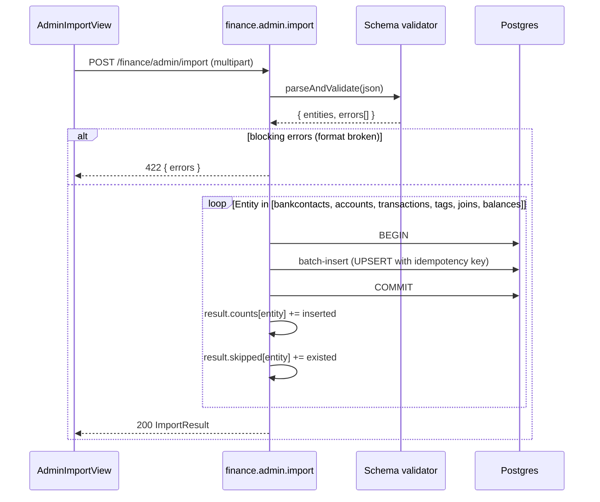

# Finance — Data import from Finanzkraft JSON

Goal: One-time import of historical financial data from the legacy Finanzkraft
app as a JSON dump into the new fk-encore database. Deliberately limited
scope: **only non-user-specific data**. Credentials, ACL and
transaction status are **not** migrated, but are re-created manually or by
the first live sync.

Status: Feature plan, implemented in stages.

---

## 1. Scope and endpoint

```
POST /finance/admin/import
Content-Type: multipart/form-data
Permission:   finance.admin
Body:         file=<finanzkraft-export.json>
```

The endpoint is not intended for regular users — `finance.admin` is in
the `adminExcludedPermissions` set (see `finance-data-model.md` §5) and
is explicitly granted to exactly one admin.

Response:
```ts
interface ImportResult {
  counts: {
    bankcontacts: number;
    accounts: number;
    transactions: number;
    tags: number;
    tagJoins: number;
  };
  skipped: {
    bankcontacts: number;    // already present (idempotency)
    accounts: number;
    transactions: number;
  };
  validationErrors: Array<{ entity: string; row: number; message: string }>;
}
```

---

## 2. What gets imported

| Entity | Import? | Remark |
|---|---|---|
| Bank contact master data | ✅ | without credentials, without user assignment |
| Account master data | ✅ | without ACL |
| Transactions | ✅ | without status, `source='import'` in `finance_account_balance` |
| Tags | ✅ | `source='user'` (historically confirmed) |
| `finance_tag_transaction` | ✅ | historical tag assignments, `confidence=NULL` |
| `finance_account_access` (ACL) | ❌ | assigned manually afterwards via `AccountAssignmentView` |
| `finance_transaction_status` | ❌ | table does not exist in the new schema |
| Credentials | ❌ | re-entered by the user |
| Categories / rules | ❌ | dropped in the new design (see `finance-tagging-and-ai.md`) |
| Balance history | ✅ (optional) | if present in the export, with `source='import'` |

The ACL is deliberately left out, because the legacy role model
(`Fk_AccountReader`/`Fk_AccountWriter`) cannot be mapped 1:1 onto the new user
master and the admin wants to review the assignment anyway.

---

## 3. Import order

The order is dictated by foreign keys:

1. **Bank contacts** (`finance_bankcontact`) — master data without
   `credentials_encrypted`, `sync_times = []`.
2. **Accounts** (`finance_account`) — FK to bank contacts.
3. **Transactions** (`finance_transaction`) — FK to accounts.
4. **Tags** (`finance_tag`) — standalone, but before the joins.
5. **`finance_tag_transaction`** — FK to tags + transactions.
6. **`finance_account_balance`** (optional) — FK to accounts.

Each stage runs in its own DB transaction. Errors in stage N
roll back only that stage; preceding stages remain persisted.
Per-row validation errors are collected and returned in the response
— **no** partial abort on individual broken rows.

---

## 4. Flow



---

## 5. Idempotency (re-import)

A re-import of the same JSON must not create duplicates. Detection
via **natural keys**:

| Entity | Natural key | Behavior on match |
|---|---|---|
| `finance_bankcontact` | `(blz, login)` | skip (no overwriting of credentials/sync times) |
| `finance_account` | `iban` (fallback: `bankcontact_id + account_number`) | skip |
| `finance_transaction` | `(account_id, dedupe_hash)` (see `finance-data-model.md` §3) | skip |
| `finance_tag` | `(name, source='user')` | skip |
| `finance_tag_transaction` | `(tag_id, transaction_id)` | skip |

Skipped counts are returned in the response, so that the admin
can understand why a re-import inserts fewer new rows than
expected.

---

## 6. Subsequent step: user assignment

Directly after the import, **no accounts** are visible to regular users
— `finance_account_access` is empty, and every query on accounts goes
through the ACL filter (see `finance-data-model.md` §5).

The admin opens `AccountAssignmentView` (see `finance-frontend.md`)
and specifies per account which fk-encore users see it as `read` or
`write`. Each user enters credentials themselves via
`BankcontactDetailView` before the first live sync starts.

---

## 7. Performance

- **Batch size**: 1000 rows per insert (transactions, tag joins).
- **Drizzle `values()` array** instead of single inserts, to save
  round trips.
- **Indexes**: the duplicate check from §5 runs against the unique indexes from
  `finance-data-model.md` §3; with 100k transactions the import
  takes, by experience, a few minutes.
- **Timeout**: the endpoint runs as a normal Encore API; for very
  large exports, possibly switch to an asynchronous import job pattern (status
  polling). For the MVP the synchronous endpoint suffices.

---

## 8. Filesystem dropbox + daily backup

The HTTP path in `AdminImportView` runs into the 5-minute gateway
timeout as soon as the import takes longer — a real migration with
~50,000 transactions is well above that. For exactly these cases there
is a filesystem path that works without HTTP:

### 8.1 Import dropbox

`finance/import-pending.ts` starts a **chokidar watcher** at boot
on `${FINANCE_IMPORT_DIR}/` (default `/data/finance-import` →
mounted as `/mnt/data/finance-import`) and, on the first tick, a
**boot scan** over all files already in the directory.
Files with the suffix **`*.pending.json`** are detected as soon as
their size has remained stable for `FINANCE_IMPORT_STABILITY_MS` ms (default 5 s).

- Each detected file is sent through `runImport()` with `wipe_first: true`
  — the dropbox semantics are *"this file IS the desired
  financial state"*.
- Success: rename to `<basename>.imported-<ISO-timestamp>.json`. On
  validation errors, a sibling file
  `<basename>.imported-<ts>.errors.json` lies next to it.
- Failure: rename to `<basename>.failed-<ts>.json` plus
  `<basename>.failed-<ts>.error.txt`.

In addition, the module internally exposes
`POST /internal/finance/scan-pending-imports` — the same mutex-
protected `runScan()` as the watcher, serving as a manual trigger.
There is deliberately no periodic cron for the dropbox: the
chokidar watcher reacts live to every new file anyway, an
additional 5-minute tick would be just load without added value.

The other finance schedules (FinTS sync, TAN cleanup, daily
snapshot) run via `lib/local-cron.ts` — Encore.ts CronJobs do not fire
automatically in self-host Docker, hence the custom mini
scheduler.

A singleton mutex at module level prevents overlapping runs for very
large imports; while a run is in progress, the next one immediately returns
`skipped_locked: true` and exits.

Logging: stage boundaries via `encore.dev/log`, in the tx stage additionally
a heartbeat every **1000 rows** with counts + elapsed — so that a
50k run produces ~50 progress lines in the container log instead of 5
minutes of silence.

### 8.2 Daily backup

`finance/export-cron.ts` writes at **03:00 UTC** a complete
snapshot of all `finance_*` user tables to
`${FINANCE_EXPORT_DIR}/finance-export-YYYY-MM-DD.json` (default
`/data/finance-export` → `/mnt/data/finance-export`). The format is
exactly the same as the `runImport` input, so that the worst-case
restore is a single `cp`:

```sh
cp /mnt/data/finance-export/finance-export-2026-04-20.json \
   /mnt/data/finance-import/restore-2026-04-25.pending.json
# next 5-min tick wipes + restores
```

Rotation: by default the last 30 snapshots are kept,
older ones are deleted (`FINANCE_EXPORT_KEEP` env var override). Since the
filename contains the day, a same-day re-run overwrites
itself — no duplicate snapshots.

### 8.3 What is in the snapshot

| Table | In snapshot? | Note |
|---|---|---|
| `finance_currency` | ✓ | Seeded idempotently in stage 0 during import. |
| `finance_bankcontact` | ✓ | Without `credentials_encrypted` (key-locked, plaintext cannot be recovered). |
| `finance_account` | ✓ | incl. `fints_account_number` for live-sync continuity. |
| `finance_transaction` | ✓ | All columns incl. SEPA fields from 0055. |
| `finance_tag` (source='user') | ✓ | AI suggestions not included — recomputed by the LLM. |
| `finance_tag_transaction` (user tags) | ✓ | Composite key `(account, booking_date, dedupe_hash)`. |
| `finance_account_balance` | ✗ | Re-derived by the next sync. |
| `finance_account_access` | ✗ | Admin sets manually via `AccountAssignmentView`. |
| `finance_tan_session` | ✗ | Transient (10 min TTL). |

### 8.4 Volume setup (`docker-compose.yml`)

Both directories are attached to the host as bind mounts:

```yaml
finance_import:
  driver: local
  driver_opts: { type: none, o: bind, device: "${HOME}/f4mil_data/finance-import" }
finance_export:
  driver: local
  driver_opts: { type: none, o: bind, device: "${HOME}/f4mil_data/finance-export" }
```

You can adjust the host paths. For multi-host backups, simply point the
export path at e.g. a NAS/SMB mount.

---

## 9. References

| Location | Purpose |
|---|---|
| `finance-data-model.md` §3 | Duplicate detection, `dedupe_hash` |
| `finance-data-model.md` §5 | Permission `finance.admin`, ACL filter |
| `finance-frontend.md` | `AdminImportView`, `AccountAssignmentView` |
| `finance/import-pending.ts` | Dropbox cron, suffix pattern, singleton lock |
| `finance/export-cron.ts` | Daily snapshot, rotation |

---

## 10. Open points

- **Balance history**: What `as_of` granularity is present in the export
  (per transaction, per day, per month)? Currently it is considered neither in the snapshot
  nor in the import — it is re-created by the next sync.
- **Push notification on failed imports**: Currently a
  `*.failed-…json` simply stays in the directory. Optionally
  push.service.ts could ping the owner user.
