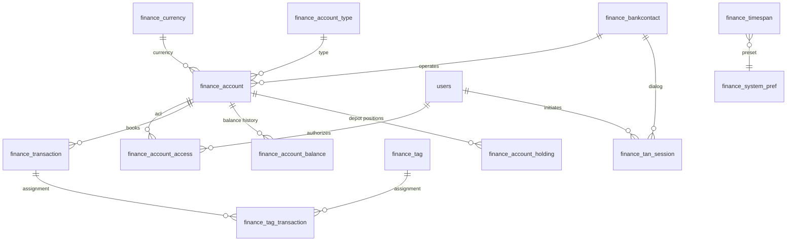

# Finance — Data model & migration

Goal: Greenfield finance module alongside `photos` and `documents` in fk-encore.
This document defines tables, indexes, constraints, the initial migration
`0043_finance_initial.sql` and the new permissions. Classification
runs exclusively via flat tags (no categories, no rules).

Status: Feature plan, implemented in stages.

Addendum: The tables and endpoints added later for
finance basket actions (`finance_transaction_split`,
`finance_basket_snapshot`) are documented in
[`finance-basket-actions.md`](finance-basket-actions.md).

---

## 1. Table overview



Cross-relations omitted: `finance_system_pref` is a pure key-value
store without FK; `finance_timespan` serves only as a preset lookup for
the frontend.

---

## 2. Drizzle definitions

Style as in `db/schema.ts` — `pgTable`, `bigserial` for high-volume tables,
`numeric(12,2)` for monetary amounts, `timestamp({ mode: "string" })`, `pgEnum`,
`jsonb().$type<…>()` for typed JSON columns, join tables with
`primaryKey({ columns: [...] })`.

### 2.1 Enums

```ts
export const financeAccountLevelEnum = pgEnum("finance_account_level", [
  "read",
  "write",
]);

export const financeTagSourceEnum = pgEnum("finance_tag_source", [
  "user",
  "ai",
]);

export const financeAccountKindEnum = pgEnum("finance_account_kind", [
  "giro",
  "tagesgeld",
  "festgeld",
  "kredit",
  "depot",
  "bausparen",
  "kreditkarte",
  "sonstige",
]);
```

### 2.2 Master data

```ts
export const financeCurrency = pgTable("finance_currency", {
  code: text("code").primaryKey(), // e.g. "EUR", "USD" (ISO 4217)
  symbol: text("symbol").notNull(),
  decimals: integer("decimals").notNull().default(2),
});

export const financeAccountType = pgTable("finance_account_type", {
  id: serial("id").primaryKey(),
  kind: financeAccountKindEnum("kind").notNull().unique(),
  label: text("label").notNull(),
});

export const financeTimespan = pgTable("finance_timespan", {
  id: serial("id").primaryKey(),
  slug: text("slug").unique().notNull(), // e.g. "current-month", "last-year"
  label: text("label").notNull(),
  offset_days: integer("offset_days"),
  offset_months: integer("offset_months"),
});
```

### 2.3 Bank contacts and accounts

```ts
export interface FinanceSyncSlot {
  weekdays: number[]; // 0 = Sunday … 6 = Saturday
  time: string;       // "HH:MM"
  tz: string;         // IANA zone, e.g. "Europe/Berlin"
}

export const financeBankcontact = pgTable("finance_bankcontact", {
  id: serial("id").primaryKey(),
  name: text("name").notNull(),
  blz: text("blz").notNull(),
  login: text("login").notNull(),
  server_url: text("server_url").notNull(),
  tan_method: text("tan_method"),
  credentials_encrypted: text("credentials_encrypted"), // AES-GCM-Blob
  sync_times: jsonb("sync_times").notNull()
    .default(sql`'[]'::jsonb`)
    .$type<FinanceSyncSlot[]>(),
  last_sync_at: timestamp("last_sync_at", { mode: "string" }),
  last_sync_status: text("last_sync_status"),
  created_at: timestamp("created_at", { mode: "string" }).defaultNow(),
});

export const financeAccount = pgTable(
  "finance_account",
  {
    id: serial("id").primaryKey(),
    bankcontact_id: integer("bankcontact_id")
      .references(() => financeBankcontact.id, { onDelete: "set null" }),
    type_id: integer("type_id")
      .notNull()
      .references(() => financeAccountType.id, { onDelete: "restrict" }),
    currency_code: text("currency_code")
      .notNull()
      .references(() => financeCurrency.code, { onDelete: "restrict" }),
    iban: text("iban").unique(),
    fints_account_number: text("fints_account_number"),
    account_number: text("account_number").notNull(),
    label: text("label").notNull(),
    closed_at: timestamp("closed_at", { mode: "string" }),
    created_at: timestamp("created_at", { mode: "string" }).defaultNow(),
  },
  (table) => [
    uniqueIndex("finance_account_unique_bank_link").on(
      table.bankcontact_id,
      table.fints_account_number,
      table.type_id,
    ),
  ]
);
```

### 2.4 Account ACL

```ts
export const financeAccountAccess = pgTable(
  "finance_account_access",
  {
    account_id: integer("account_id")
      .notNull()
      .references(() => financeAccount.id, { onDelete: "cascade" }),
    user_id: integer("user_id")
      .notNull()
      .references(() => users.id, { onDelete: "cascade" }),
    level: financeAccountLevelEnum("level").notNull(),
    created_at: timestamp("created_at", { mode: "string" }).defaultNow(),
  },
  (table) => [primaryKey({ columns: [table.account_id, table.user_id] })]
);
```

Replaces the two Finanzkraft roles `Fk_AccountReader` and
`Fk_AccountWriter`. The level is a table column, not a role —
so the fk-encore role matrix remains untouched.

### 2.5 Transactions and balances

```ts
export const financeTransaction = pgTable("finance_transaction", {
  id: bigserial("id", { mode: "number" }).primaryKey(),
  account_id: integer("account_id")
    .notNull()
    .references(() => financeAccount.id, { onDelete: "restrict" }),
  booking_date: timestamp("booking_date", { mode: "string" }).notNull(),
  value_date: timestamp("value_date", { mode: "string" }),
  amount: numeric("amount", { precision: 12, scale: 2 }).notNull(),
  currency_code: text("currency_code")
    .notNull()
    .references(() => financeCurrency.code, { onDelete: "restrict" }),
  purpose: text("purpose"),
  counterparty: text("counterparty"),
  counterparty_iban: text("counterparty_iban"),
  fints_id: text("fints_id"), // stable FinTS transaction ID (if available)
  dedupe_hash: text("dedupe_hash").notNull(), // see §3
  raw: jsonb("raw").$type<Record<string, unknown>>(),
  created_at: timestamp("created_at", { mode: "string" }).defaultNow(),
});

export const financeAccountBalance = pgTable(
  "finance_account_balance",
  {
    account_id: integer("account_id")
      .notNull()
      .references(() => financeAccount.id, { onDelete: "cascade" }),
    as_of: timestamp("as_of", { mode: "string" }).notNull(),
    balance: numeric("balance", { precision: 14, scale: 2 }).notNull(),
    source: text("source").notNull(), // "fints" | "manual" | "import"
  },
  (table) => [primaryKey({ columns: [table.account_id, table.as_of] })]
);
```

Deliberately no dedicated status table — status will be added later as a
`pgEnum` column if needed. During the Finanzkraft import the historical
status is not migrated (see `finance-data-import.md`).

### 2.6 Depot holdings

```ts
export const financeAccountHolding = pgTable(
  "finance_account_holding",
  {
    id: bigserial("id", { mode: "number" }).primaryKey(),
    account_id: integer("account_id")
      .notNull()
      .references(() => financeAccount.id, { onDelete: "cascade" }),
    as_of: timestamp("as_of", { mode: "string" }).notNull(),
    isin: text("isin"),
    wkn: text("wkn"),
    name: text("name"),
    amount: numeric("amount", { precision: 20, scale: 8 }),
    price: numeric("price", { precision: 20, scale: 6 }),
    value: numeric("value", { precision: 18, scale: 2 }),
    currency: text("currency"),
    acquisition_date: timestamp("acquisition_date", { mode: "string" }),
    acquisition_price: numeric("acquisition_price", { precision: 20, scale: 6 }),
    created_at: timestamp("created_at", { mode: "string", withTimezone: true })
      .notNull()
      .defaultNow(),
  },
  (table) => [
    index("finance_account_holding_account_asof_idx").on(
      table.account_id,
      table.as_of,
    ),
  ]
);
```

Holds per-position snapshots from depot/securities accounts (HKWPD). Each sync
upserts all positions for a given `(account_id, as_of)`. The COALESCE-based
unique constraint `ON CONFLICT (account_id, as_of, COALESCE(isin, wkn, name))`
ensures idempotent re-syncs.

### 2.7 Tags

```ts
export const financeTag = pgTable(
  "finance_tag",
  {
    id: serial("id").primaryKey(),
    name: text("name").notNull(),
    source: financeTagSourceEnum("source").notNull().default("user"),
    created_at: timestamp("created_at", { mode: "string" }).defaultNow(),
  },
  (table) => [
    // The same tag name can exist as a user and as an ai variant,
    // so that AI suggestions do not overwrite user tags.
    uniqueIndex("finance_tag_name_source_unique").on(table.name, table.source),
  ]
);

export const financeTagTransaction = pgTable(
  "finance_tag_transaction",
  {
    tag_id: integer("tag_id")
      .notNull()
      .references(() => financeTag.id, { onDelete: "cascade" }),
    transaction_id: integer("transaction_id")
      .notNull()
      .references(() => financeTransaction.id, { onDelete: "cascade" }),
    confidence: numeric("confidence", { precision: 4, scale: 3 }), // only for source='ai'
    created_at: timestamp("created_at", { mode: "string" }).defaultNow(),
  },
  (table) => [
    primaryKey({ columns: [table.tag_id, table.transaction_id] }),
  ]
);
```

### 2.8 TAN sessions and system preferences

```ts
export const financeTanSession = pgTable("finance_tan_session", {
  tan_reference: uuid("tan_reference").primaryKey(),
  user_id: integer("user_id")
    .notNull()
    .references(() => users.id, { onDelete: "cascade" }),
  bankcontact_id: integer("bankcontact_id")
    .notNull()
    .references(() => financeBankcontact.id, { onDelete: "cascade" }),
  banking_information: jsonb("banking_information")
    .notNull()
    .$type<Record<string, unknown>>(), // lib-fints state
  challenge: text("challenge").notNull(),
  expires_at: timestamp("expires_at", { mode: "string" }).notNull(),
  created_at: timestamp("created_at", { mode: "string" }).defaultNow(),
});

export const financeSystemPref = pgTable("finance_system_pref", {
  key: text("key").primaryKey(),
  value: jsonb("value").notNull().$type<unknown>(),
  updated_at: timestamp("updated_at", { mode: "string" }).defaultNow(),
});
```

---

## 3. Indexes & duplicate detection

| Table | Index | Purpose |
|---|---|---|
| `finance_account` | `(bankcontact_id)` | FK lookup |
| `finance_account` | `unique(iban)` | Uniqueness |
| `finance_account` | `unique(bankcontact_id, fints_account_number, type_id)` | Bank-link uniqueness |
| `finance_transaction` | `(account_id, booking_date desc)` | List query |
| `finance_transaction` | `unique(account_id, dedupe_hash)` | Duplicate protection |
| `finance_transaction` | `(fints_id)` where `fints_id is not null` | Re-Import |
| `finance_tag_transaction` | `(transaction_id)` | Reverse direction |
| `finance_tan_session` | `(expires_at)` | Cleanup cron |
| `finance_account_balance` | `(account_id, as_of desc)` | Balance history |
| `finance_account_holding` | `(account_id, as_of)` | Positions per account and as-of date |

`dedupe_hash` = SHA-256 over `booking_date | value_date | amount |
currency | purpose | counterparty_iban`. If FinTS delivers a stable
`fints_id`, it is preferred for duplicate checking; `dedupe_hash`
remains as a fallback for import and manual transactions.

---

## 4. Migration `0043_finance_initial.sql`

Number `0043`, because `0042_feed_item_album_left.sql` is already taken.
The SQL is generated via Drizzle (`drizzle-kit generate`); this sketch
describes the expected content.

```sql
-- 0043_finance_initial.sql

CREATE TYPE finance_account_level AS ENUM ('read', 'write');
CREATE TYPE finance_tag_source AS ENUM ('user', 'ai');
CREATE TYPE finance_account_kind AS ENUM (
  'giro','tagesgeld','festgeld','kredit','depot','bausparen',
  'kreditkarte','bargeld','sonstige'
);

CREATE TABLE finance_currency (
  code     TEXT PRIMARY KEY,
  symbol   TEXT NOT NULL,
  decimals INTEGER NOT NULL DEFAULT 2
);

CREATE TABLE finance_account_type (
  id    SERIAL PRIMARY KEY,
  kind  finance_account_kind NOT NULL UNIQUE,
  label TEXT NOT NULL
);

CREATE TABLE finance_timespan (
  id            SERIAL PRIMARY KEY,
  slug          TEXT UNIQUE NOT NULL,
  label         TEXT NOT NULL,
  offset_days   INTEGER,
  offset_months INTEGER
);

CREATE TABLE finance_bankcontact (
  id                    SERIAL PRIMARY KEY,
  name                  TEXT NOT NULL,
  blz                   TEXT NOT NULL,
  login                 TEXT NOT NULL,
  server_url            TEXT NOT NULL,
  tan_method            TEXT,
  credentials_encrypted TEXT,
  sync_times            JSONB NOT NULL DEFAULT '[]'::jsonb,
  last_sync_at          TIMESTAMP,
  last_sync_status      TEXT,
  created_at            TIMESTAMP DEFAULT now()
);

CREATE TABLE finance_account (
  id                   SERIAL PRIMARY KEY,
  bankcontact_id       INTEGER REFERENCES finance_bankcontact(id)
                         ON DELETE SET NULL,
  type_id              INTEGER NOT NULL REFERENCES finance_account_type(id)
                         ON DELETE RESTRICT,
  currency_code        TEXT NOT NULL REFERENCES finance_currency(code)
                         ON DELETE RESTRICT,
  iban                 TEXT UNIQUE,
  fints_account_number TEXT,
  account_number       TEXT NOT NULL,
  label                TEXT NOT NULL,
  closed_at            TIMESTAMP,
  created_at           TIMESTAMP DEFAULT now()
);

CREATE UNIQUE INDEX finance_account_unique_bank_link
  ON finance_account (bankcontact_id, fints_account_number, type_id);

CREATE TABLE finance_account_access (
  account_id INTEGER NOT NULL REFERENCES finance_account(id) ON DELETE CASCADE,
  user_id    INTEGER NOT NULL REFERENCES users(id)           ON DELETE CASCADE,
  level      finance_account_level NOT NULL,
  created_at TIMESTAMP DEFAULT now(),
  PRIMARY KEY (account_id, user_id),
  CONSTRAINT finance_account_access_level_chk
    CHECK (level IN ('read','write'))
);

CREATE TABLE finance_transaction (
  id                BIGSERIAL PRIMARY KEY,
  account_id        INTEGER NOT NULL REFERENCES finance_account(id)
                      ON DELETE RESTRICT,
  booking_date      TIMESTAMP NOT NULL,
  value_date        TIMESTAMP,
  amount            NUMERIC(12,2) NOT NULL,
  currency_code     TEXT NOT NULL REFERENCES finance_currency(code)
                      ON DELETE RESTRICT,
  purpose           TEXT,
  counterparty      TEXT,
  counterparty_iban TEXT,
  fints_id          TEXT,
  dedupe_hash       TEXT NOT NULL,
  raw               JSONB,
  created_at        TIMESTAMP DEFAULT now(),
  CONSTRAINT finance_transaction_dedupe_unique
    UNIQUE (account_id, dedupe_hash)
);

CREATE INDEX finance_transaction_account_booking_idx
  ON finance_transaction (account_id, booking_date DESC);

CREATE INDEX finance_transaction_fints_id_idx
  ON finance_transaction (fints_id)
  WHERE fints_id IS NOT NULL;

CREATE TABLE finance_tag (
  id         SERIAL PRIMARY KEY,
  name       TEXT NOT NULL,
  source     finance_tag_source NOT NULL DEFAULT 'user',
  created_at TIMESTAMP DEFAULT now(),
  CONSTRAINT finance_tag_name_source_unique UNIQUE (name, source)
);

CREATE TABLE finance_tag_transaction (
  tag_id         INTEGER NOT NULL REFERENCES finance_tag(id) ON DELETE CASCADE,
  transaction_id INTEGER NOT NULL REFERENCES finance_transaction(id)
                   ON DELETE CASCADE,
  confidence     NUMERIC(4,3),
  created_at     TIMESTAMP DEFAULT now(),
  PRIMARY KEY (tag_id, transaction_id)
);

CREATE INDEX finance_tag_transaction_transaction_idx
  ON finance_tag_transaction (transaction_id);

CREATE TABLE finance_account_balance (
  account_id INTEGER NOT NULL REFERENCES finance_account(id) ON DELETE CASCADE,
  as_of      TIMESTAMP NOT NULL,
  balance    NUMERIC(14,2) NOT NULL,
  source     TEXT NOT NULL,
  PRIMARY KEY (account_id, as_of)
);

CREATE TABLE finance_account_holding (
  id                BIGSERIAL PRIMARY KEY,
  account_id        INTEGER NOT NULL REFERENCES finance_account(id)
                      ON DELETE CASCADE,
  as_of             TIMESTAMP NOT NULL,
  isin              TEXT,
  wkn               TEXT,
  name              TEXT,
  amount            NUMERIC(20,8),
  price             NUMERIC(20,6),
  value             NUMERIC(18,2),
  currency          TEXT,
  acquisition_date  TIMESTAMP,
  acquisition_price NUMERIC(20,6),
  created_at        TIMESTAMP WITH TIME ZONE NOT NULL DEFAULT now()
);

CREATE INDEX finance_account_holding_account_asof_idx
  ON finance_account_holding (account_id, as_of);

CREATE TABLE finance_tan_session (
  tan_reference       UUID PRIMARY KEY,
  user_id             INTEGER NOT NULL REFERENCES users(id) ON DELETE CASCADE,
  bankcontact_id      INTEGER NOT NULL REFERENCES finance_bankcontact(id)
                        ON DELETE CASCADE,
  banking_information JSONB NOT NULL,
  challenge           TEXT NOT NULL,
  expires_at          TIMESTAMP NOT NULL,
  created_at          TIMESTAMP DEFAULT now()
);

CREATE INDEX finance_tan_session_expires_idx
  ON finance_tan_session (expires_at);

CREATE TABLE finance_system_pref (
  key        TEXT PRIMARY KEY,
  value      JSONB NOT NULL,
  updated_at TIMESTAMP DEFAULT now()
);

-- Seeds
INSERT INTO finance_currency (code, symbol, decimals) VALUES
  ('EUR','€',2),
  ('USD','$',2);

INSERT INTO finance_account_type (kind, label) VALUES
  ('giro','Girokonto'),
  ('tagesgeld','Tagesgeld'),
  ('festgeld','Festgeld'),
  ('kredit','Kreditkonto'),
  ('depot','Depot'),
  ('bausparen','Bausparvertrag'),
  ('kreditkarte','Kreditkarte'),
  ('sonstige','Sonstiges Konto');

INSERT INTO finance_timespan (slug, label, offset_days, offset_months) VALUES
  ('current-month','Aktueller Monat',NULL,0),
  ('last-month','Letzter Monat',NULL,-1),
  ('current-year','Aktuelles Jahr',NULL,NULL),
  ('last-year','Letztes Jahr',NULL,-12),
  ('last-30-days','Letzte 30 Tage',-30,NULL),
  ('last-90-days','Letzte 90 Tage',-90,NULL);
```

---

## 5. Permissions & seed extension

Four new keys — analogous to the pattern in `db/seed.ts:38-90` (see
`module.photos` / `module.documents`):

| Key | Purpose |
|---|---|
| `module.finance` | Module toggle (navigation, dashboard tile) |
| `finance.view` | View accounts and transactions (ACL-filtered) |
| `finance.accounts.manage` | Create bank contacts / accounts, trigger TAN flow |
| `finance.admin` | ACL bypass, admin import, system preferences |

`finance.admin` belongs in the `adminExcludedPermissions` set (analogous to
`photos.purge`), so that even users with `roles.admin` get the key only if explicitly
granted and do not inherit it automatically.

```ts
// db/seed.ts (add)
await upsertPermission(db, "module.finance", "Finanzmodul aktivieren");
await upsertPermission(db, "finance.view", "Konten & Transaktionen sehen");
await upsertPermission(
  db,
  "finance.accounts.manage",
  "Bankkontakte & Konten verwalten"
);
await upsertPermission(db, "finance.admin", "Finanz-Admin (ACL-Bypass, Import)");

adminExcludedPermissions.add("finance.admin");
```

In handlers, the pattern from `user/auth-handler.ts:30-35` applies consistently:

```ts
const authData = getAuthData()!;
await requirePermission(authData, "finance.view");
```

Account-related endpoints (list, detail, transactions) additionally filter
via `finance_account_access`:

```sql
WHERE a.id IN (
  SELECT account_id FROM finance_account_access
  WHERE user_id = :userId
)
-- or bypass, if the caller holds 'finance.admin'.
```

That rule (`readableFinanceAccountIds` in `finance/account-acl.ts`) answers
"what may I see": lists, search, totals, reports and the assistant's queries
over bookings. The personal views answer "what is mine" with
`ownFinanceAccountIds`: accounts with `level = 'write'`, no admin bypass.
They are the anomalies, the expected payments and the portfolio (with
quotes and news of the held securities). A partner's account shared with
`read` therefore stays searchable for the assistant without turning up in
one's own expected payments or portfolio.

---

## 6. Open points

- **Duplicate detection**: Is `fints_id` stable enough for all banks used in
  production that we take it as the primary criterion? Otherwise we stay
  with the combined `dedupe_hash`. Decidable only after capturing real
  FinTS responses.
- **Retention for `finance_account_balance`**: Is one entry per day enough,
  or do we need every balance notification? Implies disk space and
  chart resolution.
- **`raw` column**: Do we store the complete FinTS response in
  `finance_transaction.raw`, or only selected fields? Raw data is
  useful for post-analyses, but enlarges the table considerably.
