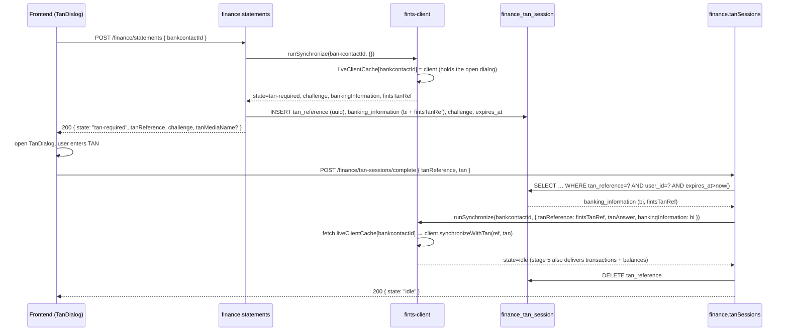
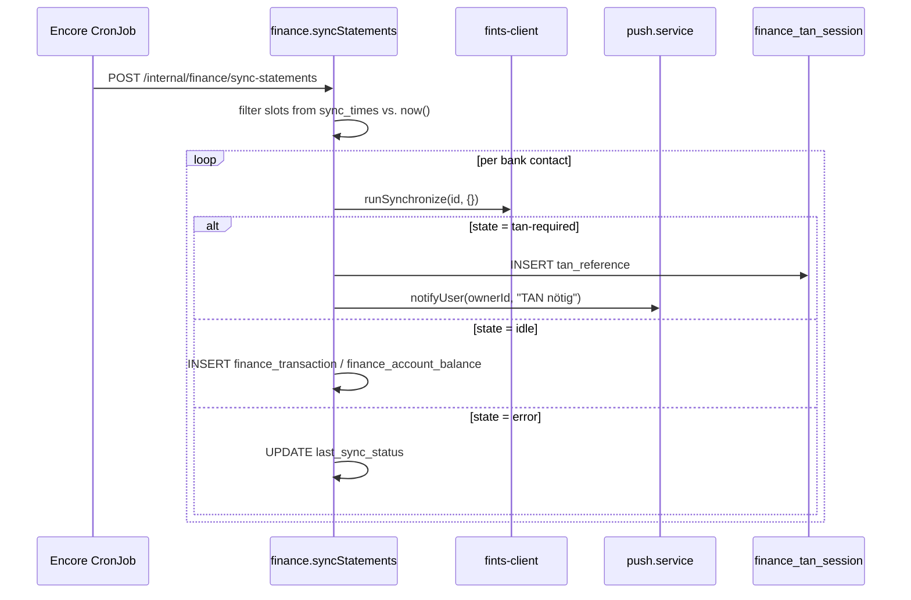

# Finance — FinTS integration, credential encryption, TAN flow, sync cron

Goal: direct connection to German bank APIs via FinTS (no PSD2
aggregator), with persistent TAN sessions, encrypted credential
storage and periodic retrieval of new transactions.

Status: Feature plan, implemented in stages.

---

## 1. Library strategy: `lib-fints` via npm

We use the npm package `lib-fints`, not the legacy Finanzkraft
in-house implementation (`dbMixinOnlineBanking.js`).

- **Dependency**: `"lib-fints": "^<current>"` in `package.json`.
- **Bugfixes**: primarily as an **upstream PR**. A fork only as plan B if
  upstream does not merge in a timely manner. This keeps our `package.json`
  semver-clean and updates painless.

---

## 2. `finance/fints-client.ts`

Thin wrapper around `lib-fints` that encapsulates dialog management and
exposes the part of the state that is relevant to us.

### 2.1 State enum

Derived from the boolean flags of the lib-fints `ClientResponse`
(`success`, `requiresTan`). The wrapper exposes the derived
representation — no `"dialog"` intermediate state any more, because lib-fints
does not tell us about it:

```ts
export type FintsDialogState =
  | "idle"           // Dialog ended cleanly, data available
  | "tan-required"   // waiting for user TAN or decoupled approval
  | "error";         // Transport or FinTS response failed
```

### 2.2 Interface (excerpt)

```ts
export interface DialogResult {
  state: FintsDialogState;
  // Set when state = "tan-required":
  tanChallenge?: string;
  tanReference?: string;
  tanMediaName?: string;
  // Set when state = "tan-required" or "idle":
  bankingInformation?: Record<string, unknown>;
  // Set when state = "error":
  errorCode?: string;
  errorMessage?: string;
}

export async function runSynchronize(
  bankcontactId: number,
  opts?: {
    tanReference?: string;
    tanAnswer?: string;
    bankingInformation?: Record<string, unknown>;
  },
): Promise<DialogResult>;
```

The implementation is not a 1:1 port of the legacy `runSynchronize`.
We replace the in-memory singleton with a stateless wrapper
that reloads its complete state (credentials via DB lookup, banking info
via function parameter) on every call. For stage 2,
`runSynchronize` covers only the `synchronize` / `synchronizeWithTan`
pair; `getAccountStatements` + `…WithTan` follow in stage 3 as
a separate function.

### 2.3 Error and retry strategy

| FinTS code | Meaning | Reaction |
|---|---|---|
| 9010 / 9050 | General error | State `error`, no retry |
| 9910 | PIN/TAN wrong | State `error`, **no** automatic retry; user must reset credentials |
| Timeout | Network / bank server | up to 2 retries with 2s/4s backoff |
| TAN method not supported | lib-fints-specific | State `error`, hint in the detail |

TAN method selection: on the first dialog the available methods
are read from the bank response. The user chooses exactly once in the frontend
(`BankcontactDetailView`); the choice ends up in `finance_bankcontact.tan_method`.

### 2.4 Required secrets: ZKA product registration

`lib-fints` requires — per PSD2 requirements of the Deutsche Kreditwirtschaft
(German banking industry committee) — a product registration. Every FinTS call needs a
`productId` + `productVersion`, which one [registers with the
ZKA](https://www.fints.org/de/hersteller/produktregistrierung)
and passes in as configuration.

Both live as Encore secrets, not in code:

| Secret | Purpose |
|---|---|
| `FinanceCredentialsKey` | 32 bytes base64, AES-256-GCM key (see §3) |
| `FinanceFintsProductId` | ZKA-registered product ID |
| `FinanceFintsProductVersion` | Semantic version of the finance module |

For local development and CI, dummy strings suffice — real values are
mandatory only for production. Setup:

```bash
encore secret set --type local FinanceFintsProductId "dev-placeholder"
encore secret set --type local FinanceFintsProductVersion "0.0.1"
```

### 2.5 Portfolio retrieval for securities accounts (HKWPD)

Besides checking/overnight-money accounts (HKKAZ/HKSAL), the client supports
retrieving securities depots via the FinTS segment HKWPD/HIWPD.

#### Depot detection

`effectiveAccountKind()` in `fints-client.ts` detects depot accounts
in two ways:

1. **Direct**: `accountType === "SecuritiesAccount"` → is immediately mapped to
   `"depot"`.
2. **Fallback**: If the bank reports the type `Miscellaneous` (e.g.
   comdirect, 1822direkt), the function checks the field `subAccountId`
   for the strings `"depot"` or `"wertpapier"` (case-insensitive).

#### Fetch routing

`fetchOneAccount()` routes depot accounts through `fetchDepotPortfolio()`
instead of the standard path HKKAZ/HKSAL. Depots use neither
`getAccountStatements` nor `getAccountBalance` — instead
`getPortfolio()` (HKWPD/HIWPD) is called.

#### Shared account numbers and `patchGetBankAccountForDepot()`

Some banks (e.g. comdirect) report the checking and depot account with
the same `accountNumber`; only the `subAccountId` distinguishes them.
The problem: `config.getBankAccount(accountNumber)` in lib-fints uses
`.find()` internally and always returns the first match (usually the checking account).
Without intervention, `canGetPortfolio` and `getPortfolio` would therefore check or use
the checking entry instead of the depot.

**Solution**: `patchGetBankAccountForDepot()` monkey-patches
`config.getBankAccount` on the client instance, so that for the shared
`accountNumber` the depot entry is preferably returned (matching via
`subAccountId`). The patch survives UPD rebuilds
during dialog initialization — lib-fints replaces
`config.bankingInformation.upd` in `initDialogInteraction.js:167`,
but not the patched method. After the portfolio retrieval completes,
the patch is reverted.

An earlier approach (re-sorting the `upd.bankAccounts` array) failed
because dialog initialization rebuilds the UPD from the bank response
and thereby undoes any re-sorting.

#### Deduplication in `runFetchAccounts()`

`runFetchAccounts()` deduplicates bank-side accounts by
`accountNumber:effectiveKind` instead of only by `accountNumber`. This way
a depot is not skipped as an alleged duplicate of the checking account
when both carry the same account number.

#### Persist matching (two-phase assignment)

`persistFetchResult()` assigns fetch results in two phases:

1. **Phase 1 — exact match**: matching on
   `(bankcontact_id, fints_account_number, kind)`. The DB account found
   is marked as "claimed".
2. **Phase 2 — fallback**: For unassigned snapshots, the
   only not-yet-claimed candidate with the same account number is
   used.

This procedure prevents a depot snapshot from being accidentally assigned to the
DB entry of the checking account (and vice versa).

#### Holdings persistence

The portfolio's `totalValue` is written as a balance to
`finance_account_balance`. The individual positions (ISIN,
WKN, name, quantity, price, value) are persisted via upsert into
`finance_account_holding`:

```sql
ON CONFLICT (account_id, as_of, COALESCE(isin, wkn, name)) DO UPDATE
```

---

## 3. `finance/encryption.ts` — credential encryption

### 3.1 Method

AES-256-GCM with a global key from the Encore secret
`FinanceCredentialsKey`. The key is 32 bytes (base64). The blob contains
`iv (12 B) | ciphertext | authTag (16 B)`, base64-encoded, and ends up in
`finance_bankcontact.credentials_encrypted`.

### 3.2 Sketch

```ts
import { secret } from "encore.dev/config";
import { createCipheriv, createDecipheriv, randomBytes } from "node:crypto";

const financeCredentialsKey = secret("FinanceCredentialsKey");

function getKey(): Buffer {
  const b = Buffer.from(financeCredentialsKey(), "base64");
  if (b.length !== 32) {
    throw new Error("FinanceCredentialsKey must be 32 bytes (base64)");
  }
  return b;
}

export function encryptCredentials(plain: string): string {
  const iv = randomBytes(12);
  const cipher = createCipheriv("aes-256-gcm", getKey(), iv);
  const ct = Buffer.concat([cipher.update(plain, "utf8"), cipher.final()]);
  const tag = cipher.getAuthTag();
  return Buffer.concat([iv, ct, tag]).toString("base64");
}

export function decryptCredentials(blob: string): string {
  const raw = Buffer.from(blob, "base64");
  const iv = raw.subarray(0, 12);
  const tag = raw.subarray(raw.length - 16);
  const ct = raw.subarray(12, raw.length - 16);
  const decipher = createDecipheriv("aes-256-gcm", getKey(), iv);
  decipher.setAuthTag(tag);
  return Buffer.concat([decipher.update(ct), decipher.final()]).toString("utf8");
}
```

Secret usage follows the pattern from `push/push.service.ts:23-27`.
Plaintext credentials are never stored in the DB or in logs.

### 3.3 Rotation

1. Set a new 32-byte secret in Encore: `encore secret set --type
   production FinanceCredentialsKey <base64>`.
2. A re-encrypt script (`scripts/finance-reencrypt.ts`) reads all
   `finance_bankcontact` rows, decrypts with the **old** key (via a
   temporary env var) and encrypts with the **new** key.
3. Deploy.

Alternative envelope encryption (root key + per-contact DEK in the row)
remains open as an extension — the MVP starts with a global key.

---

## 4. Stateful TAN flow

The legacy stack held TAN state in an in-memory singleton; that
does not work in a scaled Encore app. Instead the
state lives in `finance_tan_session` (see `finance-data-model.md` §2.7):
`tan_reference UUID`, `banking_information jsonb`, `challenge text`,
`expires_at timestamptz` (TTL 10 min).



**The live client is part of the state.** `lib-fints` attaches the open
dialog to the client instance (`FinTSClient.currentDialog`);
`synchronizeWithTan()` continues exactly this dialog. A client rebuilt from the
persisted `bankingInformation` has no
`currentDialog` and throws

```
no customer dialog was started which can continue
```

That is why `runSynchronize` puts the client into the
`liveClientCache` (TTL 30 min) **even on `tan-required`**, and the resume path takes it from
there instead of building a new one. The `banking_information` stored in
`finance_tan_session` remains useful nonetheless (warm start
on the next sync), but is in principle unsuitable for continuing a
running dialog.

The resume call is deliberately **not** retry-wrapped: a dialog is
either open or gone — retries repair nothing and only cost
the backoff budget (2s + 4s), which delays the error in the UI by 6
seconds.

Edge cases:
- **Live client gone** (container restart or TTL expiry between
  challenge and input): The bank session has ended as well.
  `complete` returns `state: "error"` with
  `errorCode: "live-client-evicted"` and a request to restart the
  sync — instead of a meaningless transport error.
- **Expired session**: `complete` throws `deadline_exceeded` (HTTP
  504); the row stays around and is deleted by the cleanup cron.
  The UI starts a fresh dialog.
- **Wrong TAN**: lib-fints again returns `state: "tan-required"`
  with a new challenge. The endpoint **keeps the session** (only
  `banking_information` + `challenge` are updated) and returns
  `200 { state: "tan-required", tanReference (same!), challenge: new }`,
  so that the UI can ask again right away. The FinTS server
  itself limits to typically 3 attempts — after that the client receives
  `state: "error"` and the session is deleted.
- **Foreign session**: if the reference belongs to another user, the
  endpoint throws `not_found` (instead of `forbidden`), so that enumeration
  of other users' sessions is not possible.
- **User dismisses dialog**: the session is not actively deleted, it expires
  through TTL; for cleanup see §5.
- **Second TAN right after the first** (comdirect/photoTAN): After the
  accepted init TAN, the bank demands SCA once more for the transaction query itself.
  `complete` therefore passes the `userId` on to
  `fetchAndPersist`, so that a follow-up session with
  `kind="statements"` is created and the UI asks again right away. Without the
  `userId` this challenge was dropped: the response was
  `state: "idle"`, the dialog closed as on success — and the
  next sync started again with the same TAN.
- **Terminal error**: `state: "error"` deletes the session
  server-side. The UI **does not close the dialog**, but shows
  `errorCode: errorMessage` and offers only "Schließen" (Close) —
  otherwise a rejected TAN cannot be told apart from a successful one. On the backend side, every non-`idle` outcome of
  `complete` is logged (`[fints] resume sync … state=…`,
  `[finance.tan-sessions] … init-TAN rejected: …`); previously the
  only hint was an HTTP 200 in the access log.

**Transport convention**: Both `POST /finance/statements` and
`POST /finance/tan-sessions/complete` return a shared
discriminated-union response (`SyncApiResponse`) with the variants
`idle` / `tan-required` / `error`. Deliberately **no** HTTP 409 Conflict
— that would force the Encore type-safe client generator into an exception
path. Instead the frontend switches on `response.state`.

---

## 5. Cron jobs

The repo uses Encore-native `new CronJob(...)` declarations with
a private internal API endpoint (`expose: false`) — see
`documents/inbox-cron.ts:28-76`. We follow exactly this pattern; **no**
external scheduler.

### 5.1 Syncing new transactions

```ts
// finance/statements-cron.ts
export const syncStatements = api(
  { expose: false, method: "POST", path: "/internal/finance/sync-statements" },
  async (): Promise<{ contacts: number; tanRequired: number }> => {
    // 1. Load bank contacts with a matching slot from sync_times
    // 2. For each: runSynchronize(...)
    // 3. On state=tan-required:
    //    - write finance_tan_session
    //    - push to owner user: "TAN für Sparkasse XY benötigt" (TAN needed for Sparkasse XY)
    // 4. On state=idle: persist transactions + balances
    // 5. Update finance_bankcontact.last_sync_at / last_sync_status
  },
);

const _ = new CronJob("finance-sync-statements", {
  title: "Finance: sync bank statements",
  every: "5m", // triggers often, the filter lives in sync_times
  endpoint: syncStatements,
});
```

The cron fires every 5 minutes (or the smallest common divisor of the
slots actually used). `sync_times` per bank contact is
timezone-aware (`{ weekdays, time: "HH:MM", tz }`); the handler converts
to UTC and decides whether this tick hits the slot (±2 min
tolerance). This way DST changeover works correctly, without a duplicate
UTC column.



### 5.2 Incremental retrieval — `from` window per account

`getAccountStatements(accountNumber, from?)` makes the bank deliver from a
cutoff date until today. Without `from`, each bank picks a different,
often ancient default (comdirect, for example, then sometimes delivers 3+ years instead of
new transactions). We therefore set `from` per account in
`fetchAndPersist`:

| Account status | `from` |
|---|---|
| Already has transactions in `finance_transaction` | `MAX(booking_date) − 14 days` |
| Freshly linked account, no data yet | `now() − 89 days` |

The 14-day overlap catches late postings and adjustments;
duplicates are discarded via the unique index `dedupe_hash` (see
`finance-data-model.md` §3) without a database conflict. The
initial retrieval, at 89 days, lies deliberately *within* the
PSD2 read-only window (some banks already treat a date exactly on the 90-day boundary
as "older than 90 days" and then demand a fresh TAN on
every sync) and therefore triggers no additional SCA — anyone who needs more history
must either use the Finanzkraft import
(`finance-data-import.md`) or temporarily raise the default value in `statements.ts`
and accept the one-time TAN prompt.

We leave `to` empty; the bank then delivers up to the current day.

```ts
// finance/statements.ts (excerpt)
const fromByAccountNumber = new Map<string, Date>();
const overlapMs = 14 * 24 * 60 * 60_000;
for (const m of maxes) {
  fromByAccountNumber.set(
    row.fints_account_number,
    new Date(new Date(m.latest).getTime() - overlapMs),
  );
}
const defaultFrom = new Date(Date.now() - 89 * 24 * 60 * 60_000);

await runFetchAccounts(client, {
  linkedAccountNumbers,
  fromByAccountNumber,
  defaultFrom,
});
```

`runFetchAccounts` (`finance/fints-client.ts`) calls the matching value
per account; unlinked bank accounts are skipped entirely,
so that each TAN is requested only once (see §5.3
below).

The plan (linked accounts + `from` map + `defaultFrom`) lives in
`statements.buildFetchPlan()` and is **also used on TAN resume**
(`tan-sessions.resumeStatementsTan` → `resumeFetchAfterTan`). Previously
the queue behind the paused account continued without a plan: without
`linkedAccountNumbers` with SCA push for unlinked accounts, without
`from` outside the 90-day window — i.e. with a new
TAN challenge for practically every subsequent account.

### 5.3 Fetch only linked accounts

Before `runFetchAccounts` opens a bank account, it checks
`linkedAccountNumbers`. If the account is not in it (e.g. because the user
deliberately did not link it in fk-encore), the loop skips
both `getAccountStatements` and `getAccountBalance`. Result:

- No SCA push prompt for accounts we are not even
  interested in.
- No duplicate TAN entries when the bank asks anew per account
  block.
- Bank accounts that have never been linked in fk-encore appear in
  the `pendingAccounts` response, so that the frontend can offer them for
  linking (see `finance-frontend.md` §4.3).

### 5.4 Cleanup of expired TAN sessions

```ts
export const cleanupTanSessions = api(
  { expose: false, method: "POST",
    path: "/internal/finance/tan-sessions/cleanup" },
  async (): Promise<{ deleted: number }> => {
    // DELETE FROM finance_tan_session WHERE expires_at < now()
  },
);

const _ = new CronJob("finance-tan-cleanup", {
  title: "Finance: cleanup expired TAN sessions",
  every: "1h",
  endpoint: cleanupTanSessions,
});
```

---

## 6. References

| Location in repo | Purpose |
|---|---|
| `documents/inbox-cron.ts:28-76` | Cron pattern (`new CronJob` + private internal endpoint) |
| `push/push.service.ts:23-27` | `secret()` usage for encryption keys |
| `user/auth-handler.ts:30-35` | `requirePermission("finance.accounts.manage")` in handlers |
| `finance-data-model.md` §2.7 | Schema `finance_tan_session` |
| `finance-data-model.md` §2.3 | `finance_bankcontact.sync_times` |

---

## 7. Open points

- **Key rotation**: global key (MVP) vs. envelope encryption (per-
  contact DEK)? The latter would be easier to mitigate after a compromised
  dump, but adds an indirection.
- **Retry budget in the sync cron**: after how many consecutive
  failed syncs do we automatically switch a bank contact to "paused"?
- **TAN push spam**: if a cron repeatedly reports `tan-required` and
  the user does not react — rate limit per bank contact?
