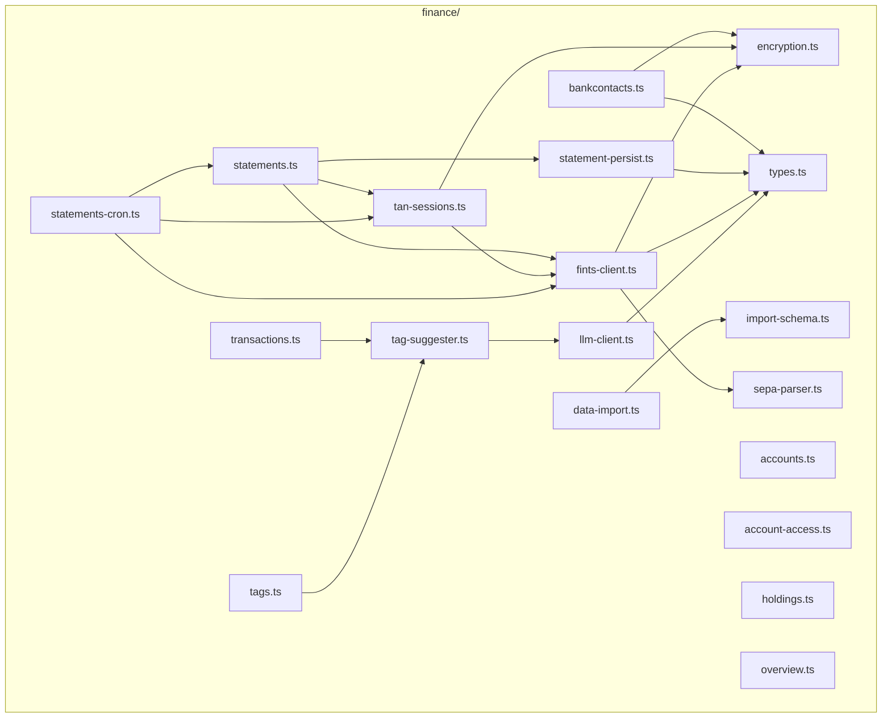

# Finance — Service File Layout

Goal: Overview of all TypeScript files that will be created in the new `finance/`
folder, with their responsibilities and their most important imports. Follows
the pattern from `documents/`: an `encore.service.ts` as the boot file,
beneath it feature-oriented endpoint modules, tests collocated.

Status: feature plan, implementation in stages.

---

## 1. Directory tree

```
finance/
├── encore.service.ts          # service definition + side-effect imports
├── types.ts                   # shared TypeScript interfaces
├── encryption.ts              # AES-GCM credential crypto
├── encryption.test.ts
├── fints-client.ts            # lib-fints wrapper, runSynchronize, runFetchAccounts
├── fints-client.test.ts
├── llm-client.ts              # Finance-specific llm-service client
├── bankcontacts.ts            # CRUD + credential set
├── bankcontacts.test.ts
├── accounts.ts                # CRUD, ACL-filtered lists, link/unlink
├── accounts.test.ts
├── account-access.ts          # ACL management (finance.admin)
├── account-access.test.ts
├── statements.ts              # POST /finance/statements (trigger sync)
├── statements.test.ts
├── statement-persist.ts       # persist logic for FetchResult → DB
├── statement-persist.test.ts
├── tan-sessions.ts            # POST /finance/tan-sessions/complete
├── tan-sessions.test.ts
├── transactions.ts            # list, detail, manual transaction
├── transactions.test.ts
├── holdings.ts                # GET /finance/accounts/:id/holdings (securities account)
├── overview.ts                # GET /finance/overview (balance overview)
├── overview.test.ts
├── tags.ts                    # tag CRUD + confirm AI suggestions
├── tags.test.ts
├── statements-cron.ts         # CronJobs: sync + tan-cleanup
├── statements-cron.test.ts
├── sync-schedule.ts           # sync time management
├── sync-schedule.test.ts
├── data-import.ts             # POST /finance/admin/import
├── data-import.test.ts
├── tag-suggester.ts           # embedding + classify, used on insert
├── tag-suggester.test.ts
├── tag-queue.ts               # tag suggestion queue (async)
├── tag-queue-api.ts           # queue endpoint for manual trigger
├── tag-queue-events.ts        # PubSub events for tag queue
├── tag-worker.ts              # background worker for tag suggestions
├── sepa-parser.ts             # SEPA remittance information parser
├── sepa-parser.test.ts
├── rate-limiting.test.ts      # rate limiting tests
├── import-schema.ts           # Zod schema for Finanzkraft JSON
├── import-pending.ts          # pending import processing
├── iso-btc-codes.ts           # ISO BTC code mapping
├── export-cron.ts             # export/backup cron
├── anomaly-detector.ts        # anomaly detection in transactions
```

31 production files + 18 test files.

---

## 2. `encore.service.ts` — boot

Analogous to `documents/encore.service.ts`. Side-effect imports for the
cron registration; no watchers of its own (unlike `documents`).

```ts
import { Service } from "encore.dev/service";

// Register cron (sync + TAN cleanup). The module exports the
// internal API endpoints and fires `new CronJob(...)` above.
import "./statements-cron";

export default new Service("finance");
```

---

## 3. Responsibility table

| File | Purpose | Endpoints (path / method) | Permission |
|---|---|---|---|
| `encryption.ts` | AES-256-GCM, `encryptCredentials` / `decryptCredentials` | — | (internal) |
| `fints-client.ts` | `runSynchronize(bankcontactId, opts)`; state enum + `clientFactory`/`sleep` test seams | — | (internal) |
| `llm-client.ts` | `embed(text)`, `suggestTags(...)` | — | (internal) |
| `bankcontacts.ts` | Bank contacts CRUD, set credentials | `GET/POST/PUT/DELETE /finance/bankcontacts[/:id]`, `POST /finance/bankcontacts/:id/credentials` | `finance.accounts.manage` |
| `accounts.ts` | Read/list accounts (ACL-filtered), deactivate | `GET /finance/accounts[/:id]`, `PATCH /finance/accounts/:id` | `finance.view` |
| `account-access.ts` | Create/remove ACL rows | `GET/PUT/DELETE /finance/admin/access/:accountId` | `finance.admin` |
| `statements.ts` | Trigger sync, possibly 409 with `tanReference` | `POST /finance/statements` | `finance.accounts.manage` |
| `tan-sessions.ts` | Complete TAN, lifecycle | `POST /finance/tan-sessions/complete`, `DELETE /finance/tan-sessions/:ref` | `finance.accounts.manage` |
| `transactions.ts` | List/detail, manual transaction, tag promotion | `GET /finance/transactions[/:id]`, `POST /finance/transactions`, `POST /finance/transactions/:id/tags/promote`, `POST /finance/transactions/batch-tag` | `finance.view` |
| `tags.ts` | Tag list, suggest batch | `GET /finance/tags`, `POST /finance/tags/suggest` | `finance.view` |
| `statements-cron.ts` | Cron: sync + TAN cleanup | `POST /internal/finance/sync-statements`, `POST /internal/finance/tan-sessions/cleanup` | (internal, `expose: false`) |
| `data-import.ts` | Finanzkraft JSON import | `POST /finance/admin/import` | `finance.admin` |
| `tag-suggester.ts` | On TX insert: embed + classify, persist suggestions | — | (internal) |
| `import-schema.ts` | Zod schema of the Finanzkraft JSON | — | (internal) |
| `types.ts` | Shared interfaces (`FinanceSyncSlot`, `DialogResult`, …) | — | — |
| `statement-persist.ts` | `persistFetchResult(bankcontactId, result)`: writes transactions, balances and holdings from a FetchResult to the DB. Two-phase matching (exact kind → unclaimed fallback). | — | (internal) |
| `holdings.ts` | Query securities account positions | `GET /finance/accounts/:id/holdings` | `finance.view` |
| `overview.ts` | Account overview with balances, sections | `GET /finance/overview`, `PUT /finance/overview` | `finance.view` |
| `sepa-parser.ts` | SEPA remittance information parser (EREF, KREF, MREF, CRED, …) | — | (internal) |
| `tag-queue.ts` | Asynchronous tag suggestion queue | — | (internal) |
| `tag-worker.ts` | Background worker for tag suggestions | — | (internal) |
| `anomaly-detector.ts` | Anomaly detection (unusual amounts, new counterparties) | — | (internal) |

Every handler follows the pattern from `user/auth-handler.ts:30-35`:

```ts
const auth = getAuthData()!;
await requirePermission(auth, "finance.view");
```

Account-related reads additionally with an ACL filter (see
`finance-data-model.md` §5).

---

## 4. Import topology

Only the most important dependencies — Drizzle / `db/database` / `users`
are omitted as a given.



Observations:
- `encryption.ts` is the single source of truth for crypto; both endpoint
  modules and the FinTS client pull it in.
- `fints-client.ts` is the only consumer of `lib-fints` — tests
  mock this wrapper, not the library directly.
- `tag-suggester.ts` encapsulates the AI pipeline from
  `finance-tagging-and-ai.md` §3 and is used both by the synchronous insert
  in `transactions.ts` and by the batch endpoint in `tags.ts`.
- The cron imports the endpoint functions from `statements.ts` /
  `tan-sessions.ts` (Encore lets a CronJob point directly at an API
  endpoint).

---

## 5. Relationship to existing modules

| Existing | Used by | Purpose |
|---|---|---|
| `db/database`, `db/schema` | all endpoint modules | Drizzle access |
| `db/seed.ts` | (migration time) | register new permissions |
| `user/auth-handler.ts` | every handler | `requirePermission` |
| `push/push.service.ts` | `statements-cron.ts`, `tan-sessions.ts` | push when a TAN is needed |
| `llm-service/` (FastAPI) | `llm-client.ts` | `/embed`, `/classify` |

No changes to existing modules except the seed patch in
`db/seed.ts` (see `finance-data-model.md` §5).

---

## 6. Conventions

- **File names**: kebab-case (`account-access.ts`), matching
  `documents/`.
- **Test file names**: collocated, `*.test.ts` (Vitest, see
  `finance-testing.md` — follows as the next document).
- **Boot logs**: `console.log("[boot] finance/<file>: …")` analogous to
  `documents/`.
- **No default exports** except `encore.service.ts`.
- **Endpoint functions** as `export const xxx = api(...)`, named after
  their action (`listAccounts`, `getAccount`, `syncStatements` …).
- **Internal endpoints** strictly under `/internal/finance/*` with
  `expose: false`.

---

## 7. Open points

- **Single-file endpoints vs. modules**: is it fine for endpoints and their
  helpers to live in the same file, or do we split endpoints (`*.ts`)
  and logic (`*-ops.ts`) as in `documents/document-ops.ts`? Tendency:
  stay with the documents style, i.e. split as soon as a file exceeds 400
  lines.
- **Shared `db.ts`**: Do we need `finance/db.ts` for recurring
  queries (e.g. ACL filter), or does that stay in the endpoint modules?
  Recommendation: only extract once the same SQL block appears 3 times.
- **`tag-suggester.ts` synchronous or queue**: so far planned as a synchronous
  best-effort on insert; for bulk imports possibly queue-based.
  The architecture decision belongs to `finance-tagging-and-ai.md` §7.
