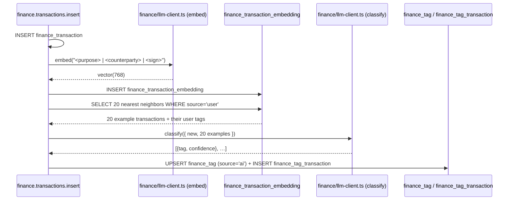

# Finance — Flat Tags and AI Tagging

Goal: Transactions are classified not via categories or rules
but via **flat tags that can be assigned multiple times**. New transactions
automatically receive AI suggestions from the `llm-service` on insert; the user
confirms or discards them. Analysis queries use free-text questions that are
translated into tag filters.

Status: feature plan, implementation in stages.

---

## 1. Design decision: flat tags instead of a hierarchy

The legacy Finanzkraft had a hierarchical category tree
plus a rule engine. Neither is ported. Rationale:

- **A transaction almost always belongs to several clusters
  at once** — a restaurant visit in Florence is at the same time
  `urlaub`, `italien-2024`, `restaurant`, and it cannot be placed
  consistently in a single tree.
- **Flexible cross-cutting**: sums can be aggregated over arbitrary tag
  combinations, instead of only along a hierarchy.
- **Less maintenance effort**: no rule engine that has to be adjusted
  again later when a shop is renamed or a new
  contractual partner is added.

Example clusters that can be mapped cleanly this way:

| Cluster | Tag set |
|---|---|
| "Expenses Italy vacation 2024" | `urlaub` + `italien-2024` |
| "Retirement provision, annual payments" | `altersvorsorge` + `jährlich` |
| "Maintenance of property X" | `immobilie-x` + `instandhaltung` |
| "Return on investment A" | `kapitalanlage-a` + `rendite` |
| "Payments into life insurance B" | `lebensversicherung-b` + `einzahlung` |

Recommended tag convention (not enforced, only for consistency in the
UI suggestion list): lowercase, hyphen instead of spaces,
optionally the year as a suffix.

---

## 2. Data model cross-reference

See `finance-data-model.md` §2.6. Key points:

- `finance_tag(id, name, source enum('user','ai'), created_at)` with
  `UNIQUE(name, source)` — the same tag name can exist as a user and as an
  AI variant, so that AI suggestions do not overwrite user tags.
- `finance_tag_transaction(tag_id, transaction_id, confidence numeric(4,3))`
  — `confidence` is only set for `source = 'ai'`.
- **Promotion**: if the user confirms an AI tag, the join entry is
  re-pointed: the AI tag entry is deleted, a user tag join entry is
  created (`confidence = NULL`). If the same user tag does not exist yet, it
  is created on promotion.

---

## 3. AI tagging pipeline

### 3.1 `llm-service` integration

The `llm-service` already exists in the repo and is used by the documents
pipeline — see `documents/llm-client.ts`. It offers two
relevant endpoints:

- `POST /classify` — structured JSON response (Llama in JSON mode).
- `POST /embed` — 768-d embeddings from `multilingual-e5-base`, for
  `pgvector`.

The Finance module gets its own `finance/llm-client.ts`, which adopts
the same HTTP style (timeout, `LlmServiceUnavailableError`)
but holds Finance-specific prompts.

### 3.2 Similarity: pgvector embeddings

`pgvector` is already active in the project (`document_embeddings` in
migration `0027_documents.sql`, HNSW index, `vector(768)`). The Finance
module mirrors the pattern:

```sql
-- in 0043_finance_initial.sql (optional) or later
CREATE TABLE finance_transaction_embedding (
  transaction_id BIGINT PRIMARY KEY
                  REFERENCES finance_transaction(id) ON DELETE CASCADE,
  embedding      vector(768) NOT NULL,
  created_at     TIMESTAMP DEFAULT now()
);

CREATE INDEX finance_transaction_embedding_hnsw
  ON finance_transaction_embedding
  USING hnsw (embedding vector_cosine_ops);
```

The embedding input is `"<purpose> | <counterparty> | <amount-sign>"`
(sign as a token, so that income and expenses cluster separately).

Trigram similarity as a minimal fallback is possible, but in our
experience delivers significantly worse clustering as soon as purposes
are only loosely standardized. **Recommendation: start directly with
embeddings**, in line with the documents.

### 3.3 Pipeline per new transaction



**Trigger variants**:
- **A — synchronous on insert** (MVP): best-effort, errors are
  logged and do not block the insert.
- **B — batch**: `POST /finance/tags/suggest { accountId?, from?, to? }`
  for legacy data after a data import.

### 3.4 Prompt contract

The prompt text sent to the model is German and stays so (English gloss
below the block).

```
Input:
  new_transaction: { purpose, counterparty, amount, sign }
  examples: [{ purpose, counterparty, amount, sign, user_tags: [...] }] × 20

Instruction:
  - Schlage 1–5 Tags vor.
  - Verwende AUSSCHLIESSLICH Tags, die in mindestens einem Beispiel
    vorkommen. Erfinde keine neuen Tag-Namen.
  - Gib pro Tag eine Confidence zwischen 0 und 1.

Output (JSON):
  { "tags": [ { "tag": "urlaub", "confidence": 0.87 }, … ] }
```

Gloss of the instruction: suggest 1–5 tags; use EXCLUSIVELY tags that occur
in at least one example, do not invent new tag names; give a confidence
between 0 and 1 per tag.

The restriction "only tags from the examples" keeps the AI within
the existing tag vocabulary. New tags are created only by the user.

### 3.5 Persistence rules

- Existing user tag entry with `(tag, transaction_id)`? → the AI
  suggestion is **not** written (no "confirming" of what
  the user has already set).
- Existing AI entry with a higher confidence? → do not overwrite.
- Confidence < 0.3 → discard (noise).

---

## 4. Analysis queries (post-MVP, separate stage)

> **Removed (2026-10):** the analysis page (`AnalysisView`, `finance/analysis.ts`,
> saved analyses and their daily suggestions) is gone. Sums with subtotals by tag
> or period now come from rule-based Sammelmappen the assistant creates
> (`create_transaction_folder`) and from `POST /finance/transactions/totals`.


### 4.1 Endpoint

`POST /finance/analysis/query`

```ts
interface Req {
  question: string;             // free text, German
  timespanHint?: string;        // optional, e.g. "2024"
  accountIds?: number[];        // optional preselection
}

interface QueryAst {
  tags: string[];
  op: "AND" | "OR";
  timespan?: { from: string; to: string };
  amountRange?: { min?: number; max?: number };
}

interface Res {
  ast: QueryAst;                // for UI chips + editability
  total: { sum: number; count: number; avg: number };
  byMonth: { month: string; sum: number }[];
  topCounterparties: { name: string; sum: number; count: number }[];
}
```

### 4.2 Parsing

`llm-service` call with the prompt (German, as sent to the model):

> Wandle die folgende Frage in einen Tag-Filter-AST um. Die verfügbaren
> Tags sind: <Liste>. Gib nur JSON zurück.

(Convert the following question into a tag-filter AST. The available tags
are: <list>. Return JSON only.)

The current tag vocabulary is passed to the prompt from `finance_tag`
(`source='user'`), so that the AI does not invent unknown tags.

### 4.3 SQL sketch

```sql
SELECT
  SUM(amount)                                AS sum,
  COUNT(*)                                   AS count,
  AVG(amount)                                AS avg,
  date_trunc('month', booking_date)          AS month
FROM finance_transaction t
WHERE t.booking_date BETWEEN :from AND :to
  AND t.id IN (
    SELECT transaction_id FROM finance_tag_transaction tt
    JOIN finance_tag tg ON tg.id = tt.tag_id
    WHERE tg.source = 'user'
      AND tg.name = ANY(:tags)
    GROUP BY transaction_id
    HAVING COUNT(DISTINCT tg.name) = :tagCount   -- AND semantics
  )
GROUP BY month
ORDER BY month;
```

For `op = 'OR'` the `HAVING` is dropped, and the `IN` subquery directly returns
the union.

### 4.4 Example

Question: "Was habe ich im Italien-Urlaub 2024 ausgegeben?" (What did I spend
on the Italy vacation 2024?)

AST (generated by the LLM):
```json
{
  "tags": ["urlaub", "italien-2024"],
  "op": "AND",
  "timespan": { "from": "2024-06-01", "to": "2024-09-30" }
}
```

The UI shows the AST as editable chips; the user can adjust the time range,
remove tags, switch the operator from AND to OR, and then
press "Aktualisieren" (refresh) — a second LLM round is not needed.

---

## 5. Stage classification

| Stage | Content |
|---|---|
| MVP (with transactions) | §3 AI tagging pipeline, embeddings table |
| Post-MVP | §4 Analysis queries + `AnalysisView` |

---

## 6. References

| Location | Purpose |
|---|---|
| `documents/llm-client.ts` | HTTP client pattern, timeout, error type |
| `db/migrations/postgres/0027_documents.sql` | pgvector + HNSW setup |
| `finance-data-model.md` §2.6 | Tag schema, source enum, promotion |

---

## 7. Open points

- **Cost budget per insert**: `classify` call directly on insert
  (synchronous) or asynchronously via an internal queue? With bulk imports
  the LLM calls add up significantly.
- **Promotion threshold**: from which `confidence` may the UI offer an
  "Auto-Apply" button that promotes all suggestions of a batch without
  individual confirmation?
- **Tag name normalization**: enforce trimming, lowercasing, umlaut mapping
  on entry? Or only soft UI suggestions?
- **Embedding re-run**: when a new tag is created, we do not need to
  recompute the existing embeddings, but the AI suggestions
  for legacy data are then outdated — the batch endpoint from
  §3.3 variant B is intended for that.
