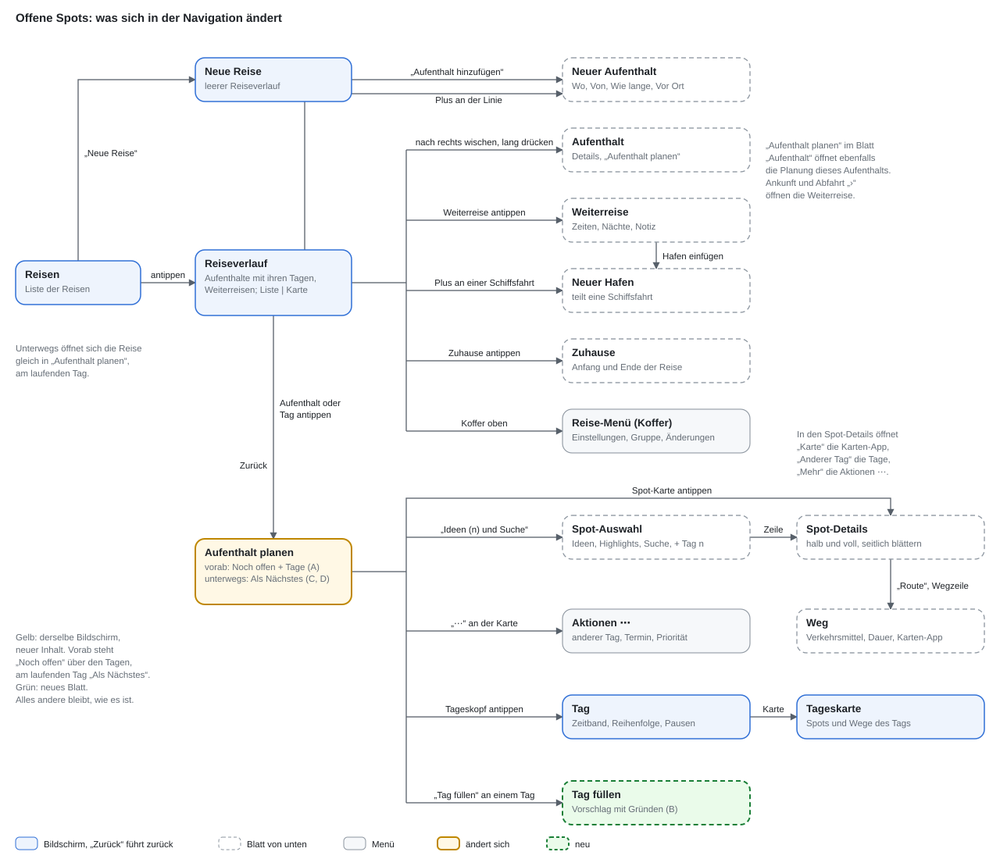
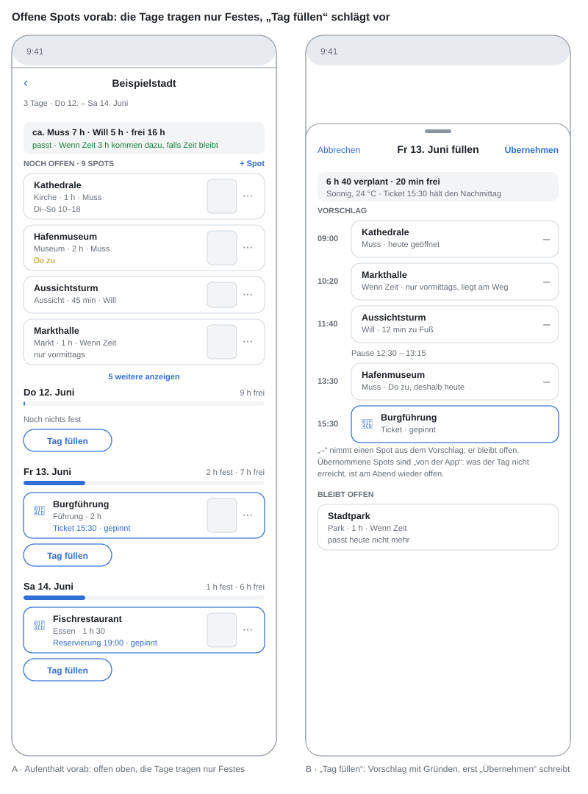
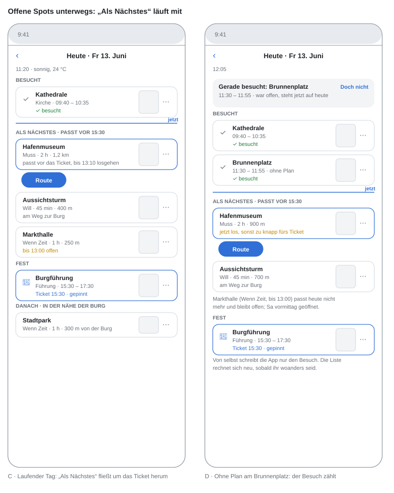

# Open spots: plan a stay without planning every day

Decided with Anton on 10.11.2026. This builds on `reise-planen-und-unterwegs.md`
and `ideen-statt-pool.md` and changes what a day of a stay holds before it
starts.

## Why

Most spots of a stay do not belong to a day. Some must happen (Muss), a few
are tied to a time (ticket, reservation, light, event, departure), and the
rest falls into place on the way. Today the app asks the user to put every
idea on a day before the trip, then re-plan when the morning goes
differently. That is planning work nobody does on holiday.

The new rule turns it around: **a day holds only what is fixed, everything
else stays open on the stay until the day it is done.**

## The model

1. **Fixed is what has a time.** A spot with a fixed time (the pin reasons
   of stage 3: ticket, light, reservation, event, departure) stands on its
   day at its hour, as today.
2. **Open is the default.** Every other idea of the stay is *open*: it has
   a priority (Muss / Will / Wenn Zeit), its opening hours, its dwell, and
   no day. These are the existing ideas of the stay; the word "open" is
   the UI's name for them (German: „Noch offen“).
3. **Placed by hand stays.** Somebody who drags or moves a spot onto a day
   means that day. Such a stop is *firm* (`placed_by = 'hand'`) and is
   never moved by the app, like today's stops.
4. **Placed by the app is soft.** "Tag füllen" puts open spots on a day as
   *soft* stops (`placed_by = 'fill'`). A soft stop that the day did not
   reach goes back to the open spots once the day is over, by itself and
   in the journal (undoable). A firm stop that was not reached is asked
   about in the evening, as today.
5. **A visit is the truth.** When the device sees the group stay at an open
   spot (the dwell rule of stage 5), the spot lands on today as visited,
   with the visit's time, whether it was planned or not. "Doch nicht"
   puts it back among the open spots.

Nothing else is written by the app. Ranking and the capacity line are
computed on read.

## Capacity: does it fit?

The stay shows one line above the open spots:

- „Muss 7 h · Will 5 h · frei 16 h in 3 Tagen“ when it fits,
- „Muss 7 h, frei 5 h – 2 h zu viel“ when even the Muss spots do not fit,
- on the running stay only the days still to come count.

*Free* is the sum of each remaining day's window minus its fixed and firm
stops and their breaks (`day-times.ts`), minus a travel share
(`OPEN_TRAVEL_SHARE`, 20 %) because the ways between open spots are not
known before they are ordered. The line says „ca.“, and it is a number for
planning, not a promise. Muss spots that do not fit by the last day get
a hint on that day: „Noch 2 Muss-Spots offen, morgen ist der letzte Tag.“

## „Tag füllen“: the manual way

A button on every coming day (and on the running day) asks for a
proposal for that day; nothing is written until „Übernehmen“.

The proposal takes open spots that:

- are open that day (`opening-hours.ts`; unclear counts as open, as in
  `suggest-day.ts`),
- suit the day's weather (`stay-weather.ts`: outdoor spots avoid a rainy
  day when a drier day has room),
- fit the free time of the day, Muss first, then Will, then Wenn Zeit,
- lie near the day's fixed points: before a fixed point the spots with the
  smallest detour on the way there, after it the ones near it
  (`detour = d(from, spot) + d(spot, fixed) − d(from, fixed)`).

It then orders the day with the existing order search (`day-order.ts`:
tickets and opening hours hard, then overrun, then way). The sheet shows the
day as it would look, each spot with why it was chosen („auf dem Weg zum
Ticket 15:30“, „heute geöffnet, Do zu“), and lets single spots be dropped
before „Übernehmen“. „Alle Tage füllen“ on the stay runs the same day by day,
for those who want the whole plan up front.

## On the road: it follows by itself

The running day replaces „Noch offen“ with **„Als Nächstes“**, a short list
of open spots that would fit now, re-sorted as the day goes:

- open now and still open after the walk there,
- fits before the next fixed point, including the way on to it,
- Muss before Will before Wenn Zeit within the same reach,
- nearest first, from where the group is.

Where the group is stays on the device (§7.1 of the trip concept). The
server answers which open spots qualify from a reference point the app
names (the last visit, the lodging, or the next fixed point), with the
latest start each one allows; the device sorts those by its own distance.
No coordinate of the user goes to the server for this.

Around a fixed point the list flows: before the ticket at 15:30 the spots
on the way there that fit in the gap rise to the top; after it, the ones
near the ticket. A visit to any open spot, seen by the device, lands on the
day as visited (see the model, point 5) and the list re-sorts from there.

For the device to see that visit, the geofences (`TripGeofencePlan`) cover
not only the next stops of the day but also the nearest open spots, up to
the region budget iOS leaves after the day's own fences; they are refreshed
on a significant location change.

## Screens

No new screen comes in. Mocks A, C and D are the existing „Aufenthalt
planen“ (`TripStayPlanView`), before the trip and on the running day; mock B
is one new sheet opened from a day on that screen. Itinerary, spot picker,
spot details, Weg, the day screen and its map stay as they are.

- **Stay planning (before the trip):** capacity line and „Noch offen“ at the
  top (open spots as cards, sorted by priority, with their hints), then the
  days, each showing only its fixed and firm stops, its fill mark and
  „Tag füllen“. Dragging an open spot onto a day makes it firm.
- **Tag füllen sheet:** the proposed day with reasons, remove per spot,
  „Übernehmen“.
- **Running day:** fixed points and what was visited, „Als Nächstes“ with
  three to five spots, each with distance and the reason it fits („passt
  vor Ticket 15:30“), „Route“ on the first. A spot visited without a plan
  shows „Gerade besucht“ with „Doch nicht“.

## What changes for existing trips

Every stop that exists today is firm (`placed_by = 'hand'`), so nothing
moves. Open spots are the ideas without a day, as today. The order
suggestion of a day stays as it is; it only orders what is on that day.

## Stages

1. **Soft and firm.** `placed_by` on `trip_plan_stops` (migration, default
   `hand`); fill-placed stops written with `fill`; a cron per plan after
   the local end of a day returns soft stops that were neither visited nor
   skipped to the open spots, one journal entry `return-open` per day.
   Capacity on read for each stay (`capacity` on the leg: muss, will,
   whenTime and free minutes, `fits`).
2. **Tag füllen.** `POST …/legs/:legIndex/days/:dayIndex/fill` returns a
   proposal (spots, order, reasons, nothing written); `POST …/fill/accept`
   writes the accepted spots as soft stops and orders the day. Selection in
   a pure `open-fill.ts` (open, weather, priority, detour, free time).
   „Alle Tage füllen“ over the coming days.
3. **Stay screen.** iOS: capacity line and „Noch offen“ on top of
   `TripStayPlanView`, days with fixed and firm stops, „Tag füllen“ per
   day, sheet `TripDayFillSheet`, hint for Muss spots at risk on the last
   days. A soft stop looks the same as a firm one except for a small „von
   der App“ mark; moving it by hand makes it firm.
4. **Als Nächstes.** `GET …/legs/:legIndex/days/:dayIndex/next-up?from=…&at=…`
   (pure `next-up.ts`: open now, fits before the next fixed point, latest
   start, priority); iOS sorts by own distance, list on the running day,
   „Route“ opens the Weg sheet.
5. **Visits to open spots.** `TripGeofencePlan` adds the nearest open spots;
   `POST …/visits` with the idea's `osmRef` and no `stopId` places the idea
   on today as visited (`visit-place.ts`), „Doch nicht“ returns it to the
   open spots; the diary counts it as a planned visit.

Each stage is its own PR with tests; the server rules are pure and
tested without a database, as the existing ones.
