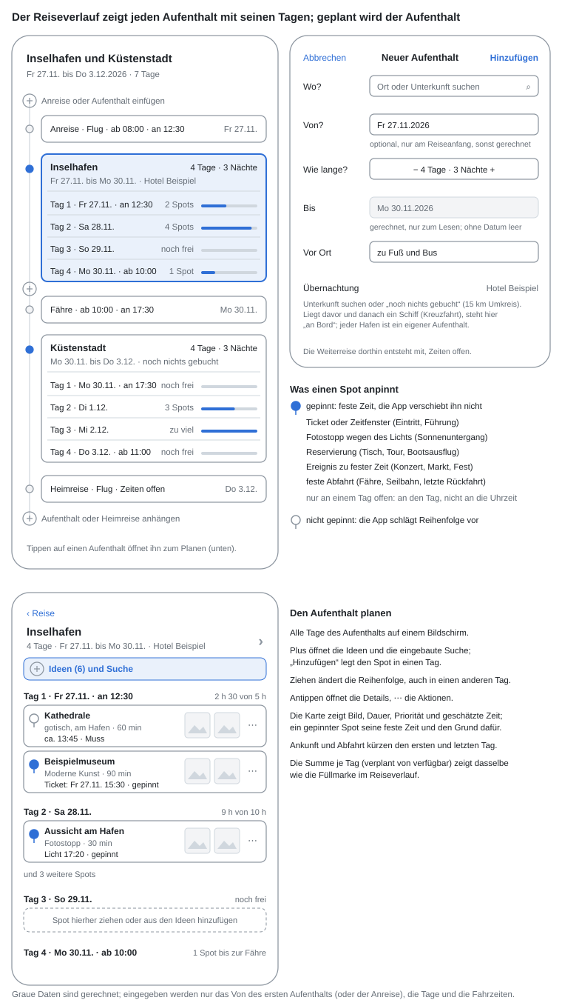
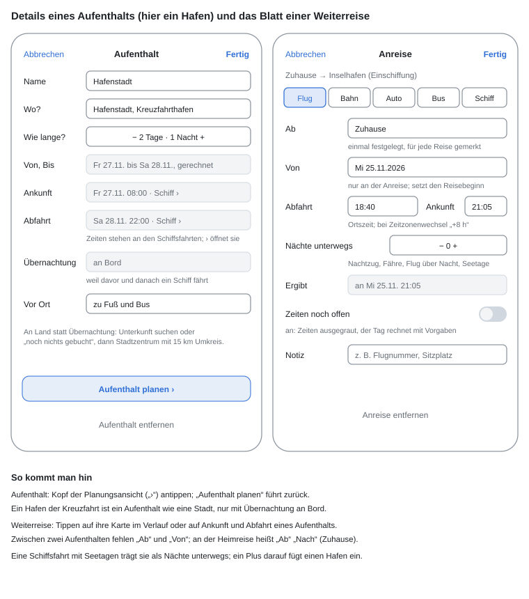
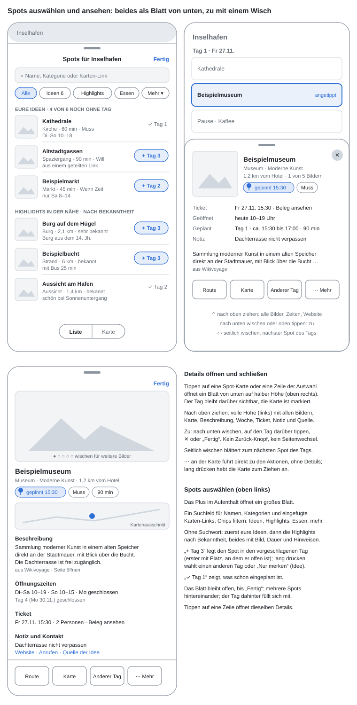
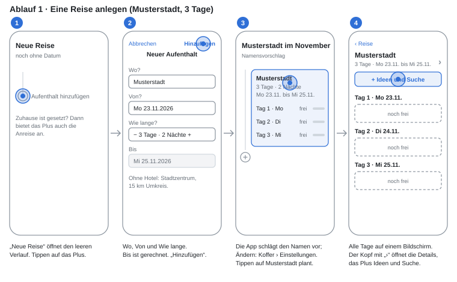
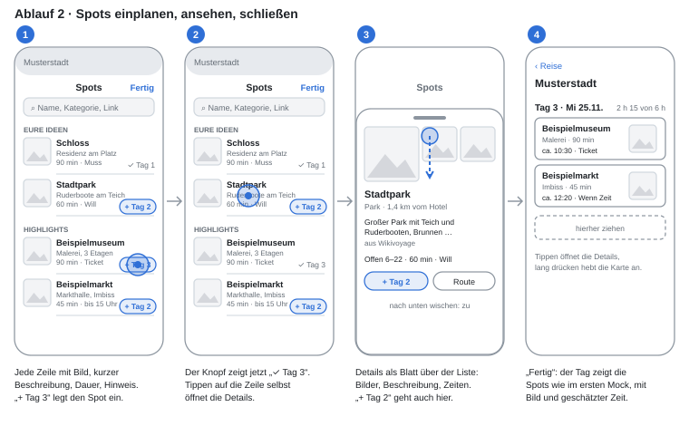
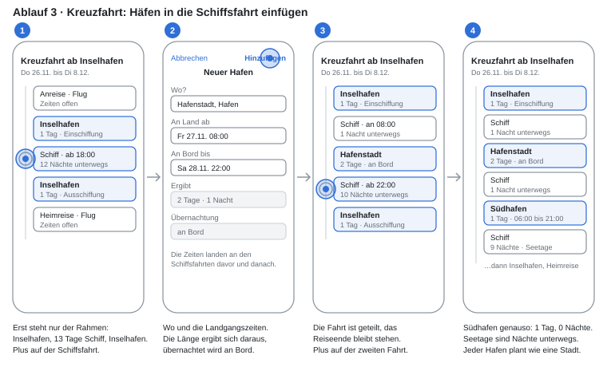
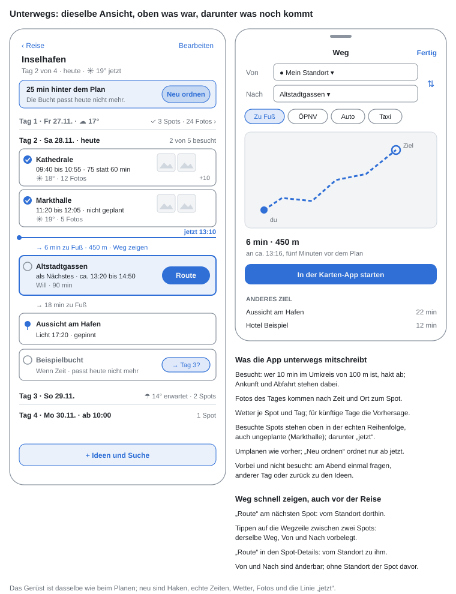
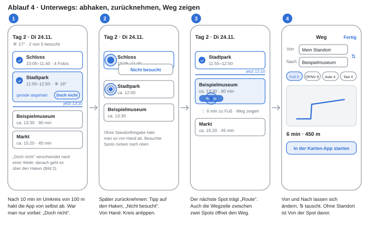
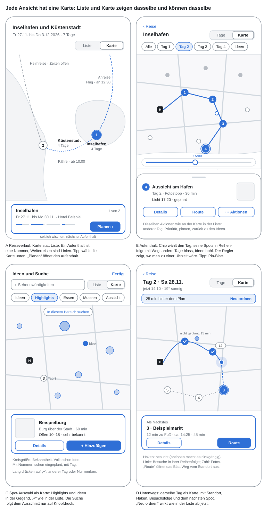
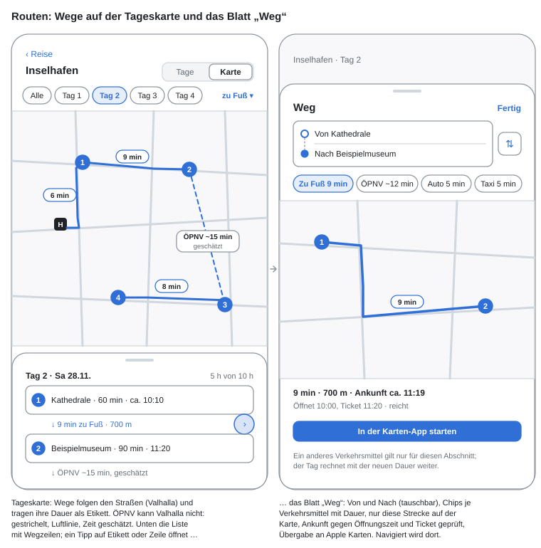

# Reiseverlauf: Reise und Stopps anlegen

Eine Reise ist eine Kette aus Aufenthalten und Weiterreisen. Sie wird auf einem Bildschirm angelegt, dem Reiseverlauf, und jeder Aufenthalt wird als Ganzes geplant: alle Tage auf einmal, gefüllt aus den eigenen Ideen und einer eingebauten Suche. Während der Reise bleibt alles gleich, nur schreibt die App mit, was wirklich passiert. Dieses Dokument beschreibt den Stand vom 9.11.2026. Alle Ortsnamen in Text und Mocks sind erfunden.

## Das Modell

Eine Reise ist eine Kette: Zuhause, Anreise, Aufenthalt, Weiterreise, Aufenthalt, Heimreise, Zuhause. Jede Angabe hat genau einen Besitzer, deshalb gibt es nichts doppelt einzugeben und nichts, was still überschrieben wird.

- **Ein Aufenthalt** besitzt Ort, Unterkunft (oder „noch nichts gebucht“), Länge in Tagen und Nächten und das Verkehrsmittel vor Ort.
- **Eine Weiterreise** besitzt Verkehrsmittel, Abfahrt, Ankunft und die Nächte unterwegs (Nachtzug, Flug über Nacht, Seetage).
- **Die Reise** besitzt nur ihren Beginn, und den nicht im Kopf: Er ist das „Von“ des ersten Aufenthalts oder der Anreise. Alle anderen Daten sind daraus gerechnet und erscheinen grau.

Ohne Datum funktioniert die Kette genauso; dann heißt es „Tag 1 bis 3“. Ein Datum kann jederzeit nachgetragen werden und verschiebt die ganze Kette.

**Tage und Nächte.** Man sagt „3 Tage Musterstadt“ und „3 Nächte Ostmetropole“. Der Stepper zeigt deshalb beides, „4 Tage · 3 Nächte“, und jede Zahl lässt sich stellen. Der Abfahrtstag gehört zum Aufenthalt. Ein Aufenthalt darf 0 Nächte haben („1 Tag · 0 Nächte“), etwa ein Hafen mit Landgang.

**Zeiten** sind immer Ortszeit am jeweiligen Ort. Die Zeitzone folgt aus den Koordinaten; wo sie wechselt, zeigt die Weiterreise den Sprung („+8 h“).

**Ohne Unterkunft** ist der Mittelpunkt eines Aufenthalts das Stadtzentrum, gesucht wird im Umkreis von 15 km.

**Kreuzfahrten.** Jeder Hafen ist ein eigener Aufenthalt, das Schiff dazwischen eine Weiterreise „Schiff“. Landgangszeiten sind Ankunft und Abfahrt dieser Schiffsfahrten, Seetage ihre Nächte unterwegs. Liegt auf beiden Seiten eines Aufenthalts ein Schiff, fragt er nicht nach einem Hotel und zeigt „Übernachtung an Bord“. So hat jeder Hafen eigene Ideen, eine Suche um den Hafen und dieselbe Planungsansicht wie eine Stadt.

**Der Name der Reise** wird nicht abgefragt. Gibt niemand einen ein, schlägt das lokale Modell einen aus Aufenthalten und Datum vor („Musterstadt im November“); Tippen auf den Titel ändert ihn.

**Zuhause** bleibt, wie es heute ist: einmal je Nutzer festgelegt. Ist es gesetzt, gibt es Anreise und Heimreise als Weiterreisen.

**Wörter.** Reise, Aufenthalt, Weiterreise (Anreise und Heimreise sind Weiterreisen von und nach Zuhause), Spot für das, was in einen Tag kommt, Idee für einen Spot, der zur Reise gehört, aber noch keinen Tag hat.

## Die drei Beispielreisen

| Gesagt | So steht es in der Kette |
| --- | --- |
| „Am 23.11.26 bin ich für 3 Tage in Musterstadt“ | Aufenthalt Musterstadt, Von 23.11., 3 Tage · 2 Nächte, ohne Unterkunft (Zentrum, 15 km). Kein Zuhause, also keine An- und Heimreise. |
| „Kreuzfahrt ab 26.11.26 in Inselhafen, 13 Tage; 27.11. 8 Uhr bis 28.11. 22 Uhr Hafenstadt; 29.11. 6 bis 21 Uhr Südhafen“ | Anreise (Zeiten offen), Inselhafen 1 Tag (Einschiffung), Schiff, Hafenstadt 2 Tage · 1 Nacht an Bord (an 27.11. 08:00, ab 28.11. 22:00), Schiff, Südhafen 1 Tag · 0 Nächte (06:00 bis 21:00), Schiff mit 9 Seenächten, Inselhafen 1 Tag (Ausschiffung), Heimreise. |
| „Flug am 20.2.27 nach Ostmetropole, drei Nächte, dann Schnellzug nach Westhafen, 4 Nächte im Hotel“ | Anreise Flug, Von 20.2., 1 Nacht unterwegs, Ankunft in Ortszeit (+8 h). Ostmetropole 4 Tage · 3 Nächte. Weiterreise Bahn, Zeiten offen. Westhafen 5 Tage · 4 Nächte mit dem Hotel als Unterkunft. |

Alle drei lassen sich mit den Bildschirmen unten vollständig anlegen; die Abläufe 1 und 3 zeigen Musterstadt und die Kreuzfahrt Schritt für Schritt.

## Der Reiseverlauf

Der Reiseverlauf ist eine senkrechte Linie, an der sich Aufenthalte und Weiterreisen abwechseln. Unter jedem Aufenthalt stehen seine Tage, jeder mit einer Füllmarke (frei, halb, voll, zu viel). So sieht man auf einen Blick, wie groß ein Aufenthalt ist und wo noch Platz ist.

- **Tippen auf einen Aufenthalt** öffnet ihn zum Planen, Tippen auf eine Tageszeile öffnet ihn gleich bei diesem Tag.
- **Tippen auf eine Weiterreise** öffnet ihr Blatt.
- **Das Plus an der Linie** fügt einen Aufenthalt ein, oben auch die Anreise. Die Weiterreise dorthin entsteht im selben Schritt mit „Zeiten offen“; niemand legt eine Fahrt eigens an. Ein Plus auf einer Schiffsfahrt fügt einen Hafen ein und teilt die Fahrt, das Ende der Reise bleibt stehen.
- **Umsortieren** per Ziehen geht nur, solange die Reise kein Datum hat; mit Datum ergibt die Reihenfolge die Daten.
- **Löschen** durch Schieben nach links, mit Rückgängig. Die beiden angrenzenden Weiterreisen werden zu einer.

Jede Änderung wirkt sofort auf die gerechneten Daten: Wer aus drei Nächten vier macht, sieht alle folgenden Karten um einen Tag wandern. Kürzt eine Änderung bereits geplante Tage, steht sie unter „Änderungen“ und lässt sich zurücknehmen.

**Neuer Aufenthalt** ist ein kleines Blatt: Wo (Ort oder Unterkunft), Von (nur am Anfang der Reise, sonst gerechnet), Wie lange (Stepper), Bis (gerechnet, nur zum Lesen), Vor Ort und Übernachtung.

## Aufenthalt und Weiterreise bearbeiten

**Die Details eines Aufenthalts** öffnet „Bearbeiten“ im Kopf der Planungsansicht; „Aufenthalt planen“ in den Details führt zurück. Sie tragen dieselben Felder wie „Neuer Aufenthalt“, dazu Ankunft und Abfahrt zum Lesen: Diese Zeiten gehören den Weiterreisen, „›“ öffnet sie.

**Das Blatt einer Weiterreise** hat Verkehrsmittel, Abfahrt und Ankunft (Ortszeit), Nächte unterwegs, den Schalter „Zeiten noch offen“ und eine Notiz für Flugnummer oder Sitzplatz. Bei der Anreise kommt „Ab“ (Zuhause) und „Von“ dazu, das den Beginn der Reise setzt. Solange die Zeiten offen sind, rechnet der Tag mit Vorgaben: Abfahrt 10:00, Ankunft 15:00, Anreise von Zuhause ab 08:00.

## Einen Aufenthalt planen

Die Planungsansicht zeigt alle Tage eines Aufenthalts auf einem Bildschirm (Mock „Der Reiseverlauf“, unterer Teil). Ankunft und Abfahrt kürzen den ersten und letzten Tag, jeder Tag zeigt „verplant von verfügbar“, dasselbe wie seine Füllmarke im Verlauf.

- **Spots** sind Karten mit Bild, Dauer, Priorität (Muss, Will, Wenn Zeit) und geschätzter Uhrzeit.
- **Ziehen** ändert die Reihenfolge, auch in einen anderen Tag; lang drücken hebt eine Karte an.
- **⋯** an der Karte führt direkt zu den Aktionen, Antippen öffnet die Details.
- **Leere Tage** zeigen ein Feld „Spot hierher ziehen oder aus den Ideen hinzufügen“.

**Gepinnt** ist ein Spot mit einer festen Zeit, die die Reihenfolge nicht verschieben darf: ein Ticket oder Zeitfenster, ein Fotostopp wegen des Lichts, eine Reservierung, ein Ereignis zu fester Zeit, eine feste Abfahrt (Fähre, Seilbahn, letzte Rückfahrt). Ein Ort, der nur an einem Tag offen ist, hängt am Tag, nicht an einer Uhrzeit. Für alle nicht gepinnten Spots schlägt die App die Reihenfolge vor.

**Essen** wird eingeplant wie jeder andere Spot, etwa ein Restaurant, auf das man sich freut; eine Tischreservierung pinnt es.

**Spot-Auswahl.** Das Plus „Ideen und Suche“ öffnet ein großes Blatt mit einem Suchfeld (Name, Kategorie oder eingefügter Karten-Link) und Chips für Ideen, Highlights, Essen und mehr. Ohne Suchwort stehen zuerst die eigenen Ideen, dann die Highlights in der Nähe nach Bekanntheit. „+ Tag 3“ legt einen Spot in den vorgeschlagenen Tag, den ersten mit Platz, an dem er offen ist; lang drücken wählt einen anderen Tag oder „Nur merken“. Das Blatt bleibt offen, bis man „Fertig“ tippt, so lassen sich mehrere Spots hintereinander einplanen.

**Spot-Details.** Tippen auf eine Karte oder eine Zeile der Auswahl öffnet ein Blatt von unten auf halber Höhe; der Tag bleibt darüber sichtbar. Nach oben ziehen zeigt alles: Bilder, Beschreibung mit Quelle, Öffnungszeiten der Woche, Ticket, Notiz, Kontakt. Zu geht es mit einem Wisch nach unten, einem Tipp auf den Tag darüber, mit ✕ oder „Fertig“. Seitlich wischen blättert zum nächsten Spot des Tags. Es gibt keinen Seitenwechsel und keinen Zurück-Knopf.

**Geteilte Links.** Ein Ort, der aus der Karten-App oder Safari geteilt wird, kommt als Idee zum nächstgelegenen Aufenthalt. Liegt er mehr als 50 km von allen entfernt, fragt die App, wohin.

## Abläufe Schritt für Schritt

Die Mocks oben zeigen Zustände. Die folgenden Abläufe zeigen, wohin man tippt und was dann erscheint; der Kreis markiert den Tipp, die gestrichelte Linie einen Wisch.

## Unterwegs

Während der Reise bleibt das Gerüst dasselbe, und man kann jederzeit umplanen. Es gibt keinen eigenen Einstieg „Heute“: Die Reise öffnet sich direkt am laufenden Tag in der Planungsansicht.

**Der laufende Tag.** Oben stehen die besuchten Spots in der Reihenfolge, in der sie wirklich besucht wurden, mit Haken, echter Zeit („75 statt 60 min“), Wetter und den ersten Fotos. Auch ein Ort, der nicht geplant war, steht dort, wenn man lang genug da war. Eine Linie „jetzt“ trennt das vom Rest; der nächste Spot ist hervorgehoben und trägt „Route“. Läuft der Tag hinter dem Plan, sagt ein Hinweis oben, was nicht mehr passt; „Neu ordnen“ ordnet nur die Spots ab jetzt, und was herausfällt, bekommt einen Vorschlag für einen anderen Tag. Vergangene Tage klappen zu einer Zeile zusammen: Wetter, besuchte Spots, Zahl der Fotos. Künftige Tage zeigen die Vorhersage, soweit es eine gibt (etwa eine Woche). Wetter gibt es nur mit Reisedatum: während der Reise das aktuelle Wetter und die Vorhersage der nächsten Tage, vor der Reise erst, wenn der Beginn in die Spanne der Vorhersage rückt. Ohne Datum oder bei einer Reise weit in der Zukunft zeigt die App kein Wetter.

**Mitschreiben.** Besucht ist ein Spot, wenn man mindestens 10 Minuten im Umkreis von 100 m war, bei langen Besuchen ein Viertel der geplanten Zeit; die Verweildauer allein genügt; Ankunft und Abfahrt werden festgehalten. Das Wetter wird je Spot zur Besuchszeit und je Tag gespeichert. Ein Spot, dessen Zeit vorbei ist und der nicht besucht wurde, bleibt bis zum Abend stehen; dann fragt die App einmal: anderer Tag oder zurück zu den Ideen.

**Von Hand abhaken und rückgängig.** Ohne Standortfreigabe markiert ein Wisch nach rechts einen Spot als besucht. Jedes Abhaken, auch ein automatisches, lässt sich rückgängig machen: Nach einem automatischen Abhaken trägt die Karte des Spots eine Weile „gerade abgehakt“ und den Knopf „Doch nicht“, für den Fall, dass man nur vorbeigegangen ist. Später geht es über einen Tipp auf den Haken und „Nicht besucht“.

**Fotos.** Fotos werden nach Aufnahmezeit und Ort einem Spot zugeordnet. Jeder sieht nur die Fotos, die ihm selbst gehören oder auf die er über ein freigegebenes Album Zugriff hat. Die Teilnahme an einer Reise erweitert keine Zugriffsrechte.

**Weg zeigen** ist ein Blatt mit Von und Nach, Verkehrsmittel (zu Fuß, ÖPNV, Auto, Taxi), kleiner Karte, Dauer und „In der Karten-App starten“. Es öffnet sich mit „Route“ am nächsten Spot (vom Standort aus), mit einem Tipp auf die Wegzeile zwischen zwei Spots (Von und Nach vorbelegt) und mit „Route“ in den Spot-Details. Von und Nach lassen sich ändern. Vor der Reise, ohne Standort, ist Von der Spot davor oder die Unterkunft.

## Mit der Karte

Jede der Ansichten oben hat eine Karte, umgeschaltet oben rechts mit „Liste | Karte“ bzw. „Tage | Karte“. Die Wahl bleibt je Ansicht gespeichert. Liste und Karte zeigen dieselben Dinge und können dasselbe: Ein Tipp auf eine Markierung öffnet dasselbe Blatt wie ein Tipp auf die Zeile, mit denselben Aktionen.

- **Reiseverlauf.** Jeder Aufenthalt ist eine nummerierte Markierung, jede Weiterreise eine Linie mit Verkehrsmittel und Zeit (gestrichelt, solange die Zeiten offen sind). Unten steht die Karte des gewählten Aufenthalts mit den Füllmarken seiner Tage und „Planen“; seitlich wischen wählt den nächsten Aufenthalt und schiebt die Karte mit.
- **Aufenthalt planen.** Chips wählen einen Tag, alle Tage oder die Ideen. Die Spots des gewählten Tags stehen nummeriert in ihrer Reihenfolge, mit dem Weg ab der Unterkunft; Spots anderer Tage sind blass, Ideen hohl. Der Regler unter der Karte zeigt, wo man nach Plan zu einer Uhrzeit wäre, etwa um ein Licht zu prüfen. Eine blasse Markierung oder eine Idee antippen bietet „+ Tag 2“ an, so lässt sich ein Tag auch auf der Karte zusammenstellen.
- **Spot-Auswahl.** Highlights erscheinen als Kreise, je bekannter, desto größer; eigene Ideen sind voll, eingeplante tragen ihre Nummer und ihren Tag. Verschieben oder Zoomen sucht nicht von selbst, erst „In diesem Bereich suchen“. Die Karte unten hat „+ Tag 3“ wie die Zeile der Liste.
- **Unterwegs.** Der laufende Tag zeigt den eigenen Standort, die besuchten Spots mit Haken, eine Linie durch die Besuche in ihrer wirklichen Reihenfolge, auch durch nicht geplante Halte (gezeichnet aus den Besuchen, eine GPS-Spur wird nicht gespeichert), und an jedem besuchten Spot die Zahl der Fotos. Der nächste Spot ist hervorgehoben und steht unten mit „Route“, was das Blatt „Weg“ vom Standort aus öffnet. Der Hinweis „hinter dem Plan“ und „Neu ordnen“ sind dieselben wie in der Liste.

**Routen.** Auf der Tageskarte folgen die Wege zwischen den Spots den Straßen, berechnet von unserem Valhalla für zu Fuß, Rad und Auto, und tragen ihre Dauer als Etikett. Geladen wird nur der gewählte Tag, Abschnitt für Abschnitt, und gespeichert; nach dem Umsortieren nur die neuen Abschnitte. ÖPNV kennt Valhalla nicht (kein Fahrplan): Solche Abschnitte sind eine gestrichelte Luftlinie mit geschätzter Zeit, die echte Verbindung liefert die Karten-App. In der Liste steht zwischen zwei Spots eine Wegzeile („9 min zu Fuß · 700 m“); ein Tipp darauf oder auf ein Etikett öffnet das Blatt „Weg“ mit Von und Nach, einer Dauer je Verkehrsmittel, nur dieser Strecke auf der Karte, der Ankunft geprüft gegen Öffnungszeit und Ticket und „In der Karten-App starten“. Ein anderes Verkehrsmittel gilt nur für diesen Abschnitt, der Tag rechnet mit der neuen Dauer weiter. Navigiert wird in Apple Karten, nicht in der App. Im Reiseverlauf sind Weiterreisen keine berechneten Routen: ein Flug ist ein Bogen, Fähre und Bahn sind Linien mit Verkehrsmittel und Zeit.

## Bestehende Reisen

Reisen, die schon angelegt sind, gehen mit ihren Aufenthalten, Weiterreisen und Tagen in das neue Modell über. Ihre Ideen bleiben, ebenso die Ideen ohne Reise und die schon in Tage eingeplanten Spots. Gesuchte Kandidaten, Strecken und Wünsche (Abstimmungen) entfallen.

## Umsetzung in Etappen

Vieles davon gibt es schon: die Kette mit `GET` und `PUT …/itinerary`, Ideen mit Priorität und Öffnungszeiten, Highlights, die Reihenfolge eines Tags, das Erkennen von Besuchen, Wetter, der Rückblick mit Fotos. Neu sind vor allem die Bildschirme und einige Regeln im Modell.

1. **Modell und Übergang.** Aufenthalte mit 0 Nächten, Zeitzone je Aufenthalt, Reisebeginn aus dem ersten „Von“, Hafen in eine Schiffsfahrt einfügen bei festem Reiseende, „an Bord“ abgeleitet, Umkreis 15 km ohne Unterkunft, Namensvorschlag. Bestehende Reisen werden übernommen wie oben beschrieben.
2. **Reiseverlauf.** Tage mit Füllmarke unter jedem Aufenthalt, Neuer Aufenthalt, Details, Blatt der Weiterreise, Plus auf der Schiffsfahrt, Ziehen ohne Datum, Wischen zum Löschen.
3. **Planungsansicht.** Alle Tage eines Aufenthalts, Karten mit Bild, Dauer, Priorität und Zeit, Ziehen zwischen Tagen, Gründe fürs Pinnen, Essen einplanbar.
4. **Spot-Auswahl und Spot-Details** als Blätter, geteilte Links zum nächsten Aufenthalt.
5. **Unterwegs.** Laufender Tag in der Planungsansicht, Abhaken nach 10 Minuten und von Hand, Rückgängig, Fotos nach Zugriffsrechten, Wetter je Spot, „Neu ordnen“ ab jetzt, vergangene Tage zugeklappt.
6. **Weg zeigen** vor und während der Reise.
7. **Aufräumen.** Alte Bildschirme, Kandidatensuche und ihre Kuratierung; Doku und Handbuch.

Den genauen Plan je Etappe führt [reise-planen-und-unterwegs.md](reise-planen-und-unterwegs.md).
