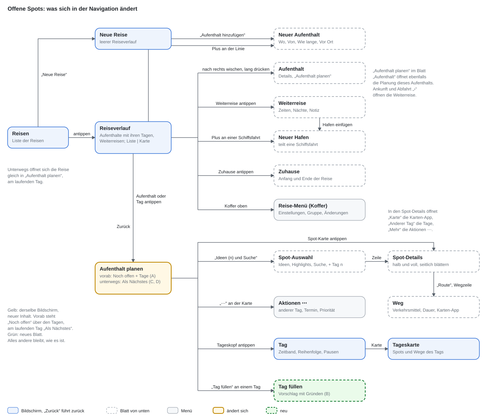
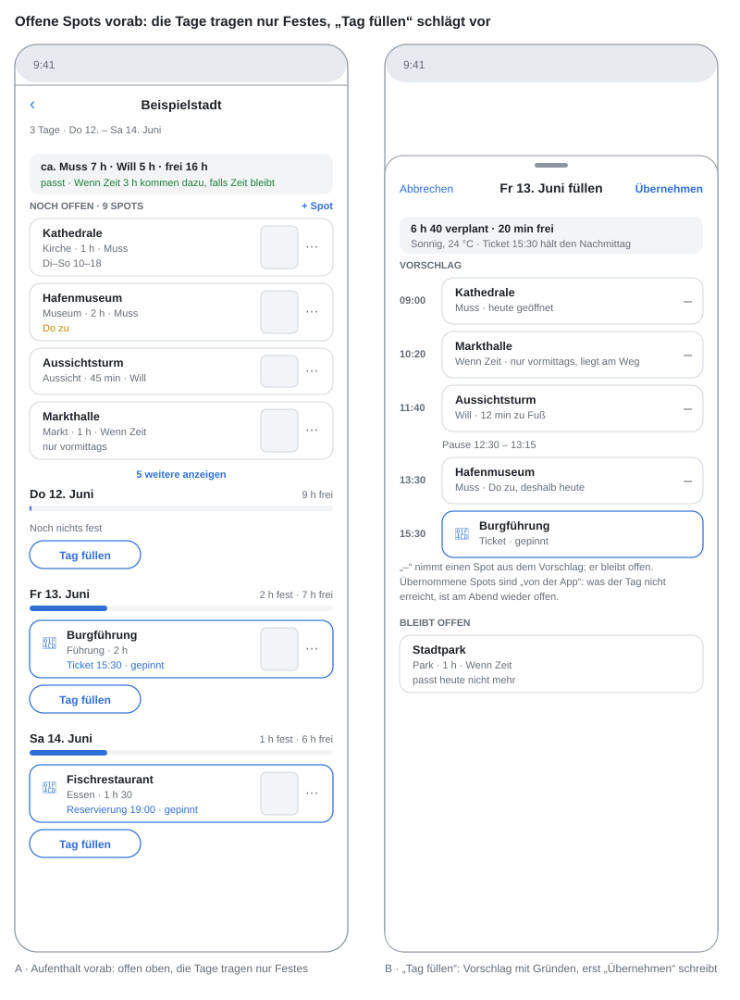
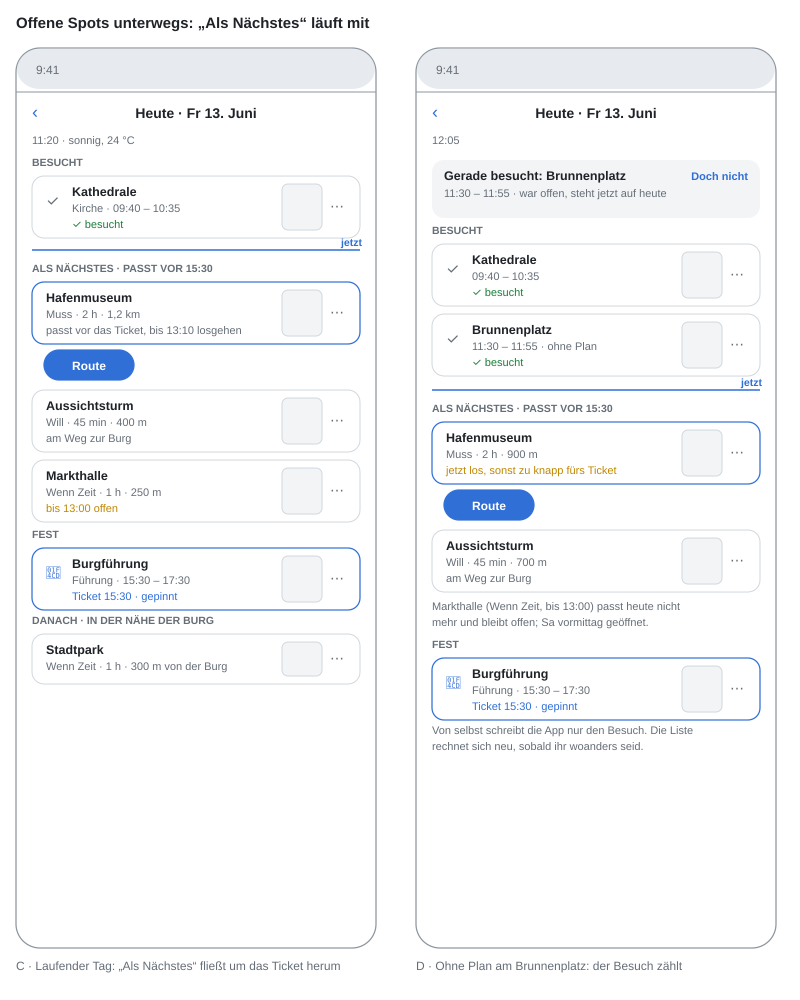

# Planning a trip and living it: one itinerary, a stay planned as a whole, the same screen on the road

Status: in progress. Decided with Anton on 2026-11-09. Stages 1 to 6 built; stage 7 in part; stage 8 (open spots, decided 2026-11-10): step 1 built (`placed-by.ts`, `open-return.ts`, `open-capacity.ts`); step 2 built on the server (`open-fill.ts`, `open-fill-api.ts`; accepting is a journal entry `fill-day`).

The UI concept, with mock-ups and step-by-step flows, lives in a Claude Doc
("Reiseverlauf: Reise und Stopps anlegen"); a copy with all mock-ups as SVG
and fictional place names is
[reise-planen-und-unterwegs-design.md](reise-planen-und-unterwegs-design.md).
This file is the
implementation plan; it repeats the rules the code has to follow so that it
can be read without the doc.

## Where we are

The itinerary plan (`reiseverlauf.md`) is built: a trip is a chain of stays
and journeys (`trip-planner/itinerary.ts`, `GET`/`PUT
/trip-planner/plans/:planId/itinerary`, iOS `TripItineraryView`). The ideas
plan (`ideen-statt-pool.md`) is built: a stay starts empty, ideas carry a
priority and opening hours, highlights and a name search fill them, a day is
one window with an ordering suggestion and a time band.

What is still wrong is the shape of the app around it:

- The itinerary shows stays and journeys, but not their days. How big a
  stay is, and where there is room, is only visible one day at a time.
- A stay is planned day by day in `TripPlanDayView`. Moving a spot to
  another day is an action in a menu, not a drag.
- Ideas, search and highlights are three places (`TripPoolView`,
  `TripPlaceSearchView`, the food list).
- A cruise cannot be entered: ports with shore leave do not fit into
  "one stay with nights".
- On the road the app records visits (`visits.ts`) and shows a review
  afterwards (`review.ts`), but the running day does not change its face:
  the visited spots do not move, the record is a separate screen.

## The rules (decided 2026-11-09)

### The model

- **One owner per value.** A stay owns place, lodging (or "nothing booked"),
  length and local transport. A journey owns mode, departure, arrival and
  nights on the way. The trip owns only its start, and that start is the
  "Von" of the first stay or of the outbound journey. Everything else is
  derived and shown grey.
- **Days and nights.** The stepper shows both ("4 Tage · 3 Nächte"); either
  number can be changed; `days` stays the stored value. A stay may have 0
  nights (`days = 1`) — a port with shore leave.
- **End date is read-only.** "Bis" is computed from start and length.
- **Time zones.** All times are local at their place. The zone follows from
  the coordinates; a journey that crosses zones shows the jump ("+8 h").
- **No lodging.** The anchor is the city centre, search radius 15 km.
- **Cruises.** Every port is a stay; the ship between ports is a journey of
  mode `ship`; shore leave times are that journey's arrival and departure;
  sea days are its nights on the way. A stay with a ship journey on both
  sides has no lodging and shows "Übernachtung an Bord". A plus on a ship
  journey inserts a port and splits the journey; the end of the trip stays
  where it was.
- **Trip name.** Not asked for. When empty, the local model proposes one
  from stays and dates; it is changed under the suitcase › Einstellungen, not by tapping the title (Anton, 10.11.).
- **Home** stays as built (`trip_user_homes`).
- **Reordering stays** by drag only while the trip has no date. Deleting a
  stay by swiping left, with undo; the two neighbouring journeys merge.
- **Shared links** land as an idea at the nearest stay; more than 50 km
  from every stay, the app asks where.

### Planning a stay

- Tapping a stay in the itinerary opens its planning view: **all days on one
  screen**, each with "planned of available" (the same figure as the fill
  bar under the stay in the itinerary). Tapping a day row opens it scrolled
  to that day.
- "Bearbeiten" in the header opens the stay's details; "Aufenthalt planen"
  in the details leads back.
- Spot cards show picture, duration, priority and estimated time. Drag
  reorders, also into another day. `⋯` opens the actions, a tap the details.
- **Pinned** is a spot with a fixed time the ordering must not move: ticket
  or time slot, photo stop for the light, reservation, event at a fixed
  time, fixed departure (ferry, cable car, last return). A place open on one
  day only hangs on that day, not on a time.
- **Food can be planned** like any other spot; a table reservation pins it.
  This replaces the rule of `ideen-statt-pool.md` stage 6 that food is never
  planned.
- **Spot picker:** one sheet with a search field (name, category, pasted map
  link) and chips (ideas, highlights, food, more). Without a query: own
  ideas first, then highlights by fame. "+ Tag n" puts the spot into the
  suggested day (the first with room on which it is open); long press picks
  another day or "keep as idea". The sheet stays open until "Fertig".
- **Spot details:** a sheet at half height over the day; drag up for
  everything; close by swiping down, tapping the day above, ✕ or "Fertig";
  swipe sideways for the next spot of the day.
- **Sheets look the same at every height** (Anton, 2026-11-09): a sheet at
  half height has the same opaque background as at full height, never the
  translucent glass iOS 26 draws at a partial detent. Every sheet with a
  partial detent calls `opaqueSheetBackground()`.

### On the road

- Same screen. No separate "Heute" entry: during the trip, the trip opens on
  the running day of its planning view.
- Visited spots move to the top in the order they were really visited, with
  a check mark, real times, weather and the first photos. An unplanned place
  where the group stayed long enough is listed too. A "jetzt" line separates
  them from the rest; the next spot is highlighted and carries "Route".
- Behind plan: a notice says what no longer fits; "Neu ordnen" reorders from
  now on only, and what falls out gets a suggested other day.
- Past days collapse to one line (weather, visited spots, photo count);
  future days show the forecast as far as there is one (about a week).
- **Checking off.** A dwell of at least ten minutes within 100 m checks a
  spot off by itself (see stage 5 for how this changes `visits.ts`). A swipe
  right checks a spot off by hand. **Every** check, automatic or manual, can
  be undone. After an automatic check the spot's card says "gerade
  abgehakt" for a while and carries "Doch nicht" (for walking past); later,
  tapping the check mark offers "Nicht besucht".
- A spot whose time has passed without a visit stays until the evening; then
  the app asks once: another day or back to the ideas.
- **Photos** are matched to spots by time and place. Everyone sees only the
  photos they own or can see through a shared album. Taking part in a trip
  grants no access to anyone's photos.
- **Weather** is recorded per spot at visit time and per day. Shown only
  with a trip date (Anton, 2026-11-09): during the trip the current weather
  and the forecast for the next days; before the trip only once its start
  falls inside the forecast range. Without a date, or with a trip far ahead,
  no weather at all.
- **"Weg"** (route sheet): from and to (current location or any spot), mode
  (walk, public transport, car, taxi), small map, duration, "In der
  Karten-App starten". Opened from "Route" on the next spot, from the way
  line between two spots (both ends prefilled) and from "Route" in the spot
  details. Before the trip, without a location, "from" is the previous spot
  or the lodging.

### Maps

Every view has a map next to its list ("Liste | Karte", "Tage | Karte"),
remembered per view. List and map show the same things and offer the same
actions: a tapped marker opens the sheet a tapped row opens.

- **Itinerary:** a numbered marker per stay, a line per journey (mode and
  time; dashed while the times are open), the selected stay's card below
  with its day fill bars and "Planen"; swiping the card selects the next
  stay.
- **Stay:** chips pick a day, all days or the ideas; the picked day's spots
  numbered in order with the way from the lodging, other days faded, ideas
  hollow; the existing time slider of `TripDayMapView` stays. A faded marker
  or an idea offers "+ Tag n".
- **Spot picker:** highlights as circles sized by fame, own ideas filled,
  planned spots with number and day; moving the map does not search until
  "In diesem Bereich suchen".
- **On the road:** own location, visited spots with a check, a line through
  the visits in their real order (drawn from the visit rows, no GPS track is
  stored), photo count per visited spot, the next spot with "Route".

### Existing trips (Anton, 2026-11-09)

Trips that already exist keep their stays, journeys and days and move into
the new model. Their ideas stay, as do ideas without a trip and spots
already placed into days. Searched candidates, routes ("Strecken") and votes
go.

## Stages

### Stage 1 — model and migration (backend)

- **Time zone per stay.** Derive the IANA zone from the stay's coordinates
  (offline lookup, no network call per request) and store it on
  `trip_plan_legs` (`time_zone text`). `itinerary.ts` returns it per stay and
  the zone jump per journey (`zoneShiftMinutes`). Arrival and departure
  minutes stay local; nothing is converted on write.
- **0-night stays** already pass `validateDays` (`days >= 1`); add tests for
  a port day between two ship journeys whose arrival and departure fall on
  the same date, and make `deriveFrames` give that day a window from arrival
  to departure.
- **Ship journeys.** Port days and journeys of mode `ship` exist already
  (`aboard.ts`, `itinerary.ts`). New: a stay with `ship` on both sides is
  `aboard` without being told so (derived on read), and `PUT …/itinerary`
  accepts an inserted port inside a
  ship journey and keeps the trip's end date: the nights of the journey are
  split between the two halves; a request that would move the end is
  refused with a message naming the stay.
- **Trip start.** The start date is set by the first stay's or the outbound
  journey's "Von"; the settings no longer write it. Existing trips keep
  their stored start.
- **No lodging.** Anchor at the city centre (place lookup), radius 15 km,
  instead of today's default.
- **Trip name.** `POST /trip-planner/plans/:planId/name-suggestion`: the
  local model gets stays and dates, returns one short name; written only
  when the trip has none. Test with a canned client.
- **Shared links.** `map-link.ts` picks the nearest stay; beyond 50 km it
  returns the candidates instead of writing.
- **Migration** (`0304_trip_ideas_everywhere.sql` plus a TypeScript step if
  the SQL gets unreadable):
  - every trip without `constraints.ideas` gets `ideas: true` and
    `voting: false`;
  - pool rows with `origin = 'search'` are deleted; rows from a find, a
    share or a manual add stay (they are ideas);
  - pool rows and stops of category `route` are deleted;
  - `trip_plan_votes` rows are deleted;
  - `trip_leg_curation` rows are deleted (the job only ordered searched
    candidates).
  Planned stops other than routes, days, fixpoints, breaks and journeys are
  untouched. Test on a trip built the old way (`TRIP_START_EMPTY=0`): after
  the migration it reads like an ideas trip with the same days and stops.

**Built (2026-11-09).** What differs from the list above:

- The zone is not stored. `trip-planner/time-zone.ts` looks it up offline
  from the anchor (`tz-lookup`) on every read, so a moved anchor can never
  leave a stale zone behind; `GET …/itinerary` carries `timeZone` per stay
  and `zoneShiftMinutes` per journey (at the arrival day, or today without
  a date).
- A port between two ship journeys is aboard in `deriveFrames` itself, so
  read and write agree (`betweenShips`). `refuseMovedCruiseEnd` refuses a
  new port whose halves move the end; the app splits the nights (stage 2).
- The settings still accept `startDate`: today's iOS settings send it. It
  goes with the date picker in stage 2.
- No lodging means no named base, or only a zone (`hasNoLodging` in
  `search-reach.ts`); the reach is at least 15 km, a car's 25 km stays.
- A shared pin beyond 50 km (`SHARE_LEG_DISTANCE_M`) gets `legIndex: null`
  and `stayChoices`, the stays nearest first. Finds keep their 150 km.
- `POST …/name-suggestion` in `trip-planner/name-suggestion.ts`.
- Migration `0304_trip_ideas_everywhere.sql`, tested in
  `ideas-everywhere-migration.test.ts`.

### Stage 2 — itinerary (iOS)

`TripItineraryView` gains the days under each stay, each with a fill bar
from the day times (`day-times.ts`: planned, free, too much). New sheets:
"Neuer Aufenthalt" (Wo, Von only on the first stay, Wie lange, Bis
read-only, Vor Ort, Übernachtung), stay details, journey sheet (mode,
departure, arrival, nights on the way, "Zeiten noch offen", note; "Ab" and
"Von" on the outbound journey). Plus on the line; plus on a ship journey
opens "Neuer Hafen" (where, ashore from, aboard until). Drag only without a
date; swipe left to delete with undo through `…/ops/undo`. Title tap edits
the name; an empty name shows the suggestion. Map variant: stays as
numbered markers, journeys as lines, the selected stay's card below.

**Built (2026-11-09).** `TripItineraryView` is a line of stays and
journeys with the days under every stay (`TripItineraryDays.rows`: label
with date, arrival and departure, "n Spots" / "noch frei" / "zu viel", fill
from `plannedMinutes` over the window) and "Liste | Karte"
(`TripItineraryMapView`: numbered stays, journeys as lines, dashed while
open, a great circle for a flight, the selected stay's card below). The
sheets are in `TripItinerarySheets.swift`: `TripStaySheet` (new and edit),
`TripJourneySheet`, `TripPortSheet` (`insertPort` in the draft splits the
ship journey and keeps the end), `TripHomeSheet`. Every sheet saves the
whole chain at once; "Sichern" is gone. Removing a stay and shortening one
offer "Rückgängig" through the journal's newest `itinerary` entry. A tap on
a stay or a day selects it in the day view until stage 3 brings the stay's
own planning view. The settings no longer show a date. A ship journey may
carry up to 30 nights (`MAX_SHIP_NIGHTS`), every other journey keeps 6.

### Stage 3 — planning view of a stay (iOS)

A new `TripStayPlanView` replaces `TripPlanDayView` as the place where a stay
is planned: all days of the stay, spot cards (picture from `trip_spot_fame`,
duration, priority, estimated time from `day-times.ts`, pin reason), drag
within and across days (writes through the existing move endpoint), an empty
day as a drop zone. Pin reasons are a field on the stop (`pin_reason`:
`ticket`, `light`, `reservation`, `event`, `departure`) next to the fixed
time that already exists; the day order (`day-order.ts`) treats them all as
hard. Food stops are allowed in a day; `day-order.ts` stops leaving them in
place unless they are pinned. Map variant: `TripDayMapView` grows day chips
(one day, all days, ideas), faded other days, hollow ideas, "+ Tag n" on a
marker.

**Built (2026-11-09).** The pin reason lives on the fixpoint that holds
the time (`trip_plan_fixpoints.pin_reason`, migration 0305), not on the
stop: the reason and the hour belong together, and a stop's `pinned`
flag already means something else ("frame-placed, never moved"). It is
set with the appointment ("Warum fest?" in the fixed-time sheet), changed
with `POST …/fixpoints/pin-reason` without a re-plan, rides through every
re-plan, and goes when the spot is untied (`pin-reason.ts`). The day
order needed nothing for pinned spots (every booked visit was already a
hard time); food is no longer held in place. `TripStayPlanView` is
the screen a trip opens on (2026-11-10): for a stay, `TripPlanDayView`
shows it under the strip of stays and journeys, and a day header pushes
the screen of one day (band, order, breaks); a transit leg keeps the day
screen. "Planen" on a stay in the itinerary leads there too. Cards carry the actions of `stopActions` behind "⋯", the
details on a tap, drag onto a card or a day through the move endpoint.
The map variant lives in the stay view (chips: all days, one day, ideas;
"+ Tag n" on a tapped marker) rather than in `TripDayMapView`.

### Stage 4 — spot picker and spot details (iOS)

One sheet replaces `TripPoolView`, `TripPlaceSearchView` and the food list as
the way in: search field, chips, own ideas first, highlights after; every
row like the stay's spot cards (picture, short description, duration,
priority or hint) and a tap on the row opens the details at once
(`highlights.ts`), "+ Tag n" with the suggested day computed on the server
(`POST …/legs/:legId/suggest-day`: first day with room on which the place is
open, from `opening-hours.ts` and `day-times.ts`), long press for another
day or "keep as idea". Spot details become a sheet with two heights, built on
the existing `TripSpotDetailView` content and `stopActions`/
`candidateActions` (CLAUDE.md "Aktionen an Spots in der iOS-App": the
actions stay in one place). Map variant of the picker (`TripSpotMapView`):
circles sized by fame, "In diesem Bereich suchen" sends the visible region
to the highlights and name search.

**Built (2026-11-10).** `POST …/legs/:legIndex/suggest-day` in
`trip-planner/suggest-day.ts` answers for up to 60 places at once (an
idea's own duration and hours win; unknown hours never count as closed;
past days are skipped; without room, the open day with most time left,
marked `full`). Highlights carry `openingHours`; highlights and the name
search take an `area` (`search-area.ts`, clamped to 300 m–25 km) — around
an area the highlights come by fame, without the model's order.
iOS: `TripSpotPickerView` (search field for name or map link, chips
Alles/Ideen/Highlights/Essen/Mehr, rows from `TripSpotPicker.items`,
"+ Tag n", long press and the details for the other days and "Als Idee
behalten", list or map with "In diesem Bereich suchen") is the way in
from the stay plan, the day's "Spot hinzufügen" and the stay sheet on a
trip of ideas; food is `TripFoodListView` aimed at the first day with an
hour left. Spot details in the stay plan are a sheet at two heights
(`TripSpotDetailPager`, swipe sideways through the day). `TripPoolView`
and `TripPlaceSearchView` stay until stage 7.

### Stage 5 — on the road (backend + iOS)

- **Checking off.** Change the rule in `visits.ts`: a dwell above the
  threshold now confirms on its own (it used to only ask). The threshold
  stays `dwellThresholdMinutes` (ten minutes, or a quarter of the planned
  stay for long visits, more for spots on the way); a photo or payment alone
  still only asks. A manual check is a visit with source `manual`. Undo is
  `DELETE /trip-planner/plans/:planId/visits/:visitId` (or `dismissed` for
  an automatic one, so the same stay is not offered again).
- **Order.** The running day lists confirmed visits first, by `arrived_at`,
  then the "now" line, then the open stops. Computed on read, nothing moved
  in the database.
- **Behind plan.** `POST …/days/:dayIndex/order` with `from: now`: only
  stops after the line are reordered; what does not fit comes back as
  `toDrop` with a suggested day.
- **Missed spots.** In the evening (a cron in `trip-planner/`), a stop of
  the running day without a visit raises one question: another day or back
  to the ideas.
- **Photos** per spot through `photo_poi_matches` plus time and place of the
  visit, filtered with `accessiblePhotoCondition` (not only `user_id` as in
  `review.ts` today) — taking part in a trip grants nothing.
- **Weather** per visit: the weather at `arrived_at` from the weather store,
  kept on the visit row (`weather jsonb`), per day as today.
- **iOS.** The planning view shows the running day as above, past days
  collapsed, "Doch nicht" on a freshly checked card, "Nicht besucht" from
  the check mark, the swipe-right check, weather only within the forecast
  range. Its map shows
  the own location, checks, a line through the visits in order (from the
  visit rows; no GPS track is stored), photo counts and the next spot with
  "Route".

**Built (2026-11-10).** A dwell above `dwellThresholdMinutes` now confirms
on its own (`assessVisit` in `visits.ts`); a photo or a payment alone still
asks. "Erledigt" by hand (`POST …/stops/status`) records a visit with source
`manual`; setting a stop open or skipped takes every check of it back
(`noteStatusByHand` in `visit.ts`, `undoVisitsOfStop`): a manual one is
deleted, a sensed one kept as dismissed, and the upsert in `recordVisit`
keeps a dismissed stay dismissed, so the next sync does not tick it again.
`DELETE …/visits/:visitId` (`undoTripVisit`) takes one visit back, also an
unplanned stay. `POST …/days/:dayIndex/order` takes `fromMinutes`: the open
stops start no earlier than now, and every `toDrop` comes back in
`elsewhere` with the day `suggestDay` would give it. The weather of a
visit's hour goes on the row (`weather jsonb`, migration 0306,
`visit-weather.ts`, off in tests with `TRIP_VISIT_WEATHER=0`). `GET
…/legs/:legIndex/days/:dayIndex/diary` (`day-diary.ts`) gives per spot the
visit's weather and the photos taken there that day — matched by POI or
within 100 m, filtered with `accessiblePhotoCondition` — and the unplanned
stays. iOS: `TripStayPlanView` shows the running day as visited (in the
order of `doneAt`), unplanned stays, a "jetzt" line, then the open stops
with a check circle; the next one is outlined and carries "Route"; a fresh
check says "Gerade abgehakt" with "Doch nicht", a tap on the check mark
offers "Nicht besucht"; "Neu ordnen" when what is left does not fit, then
"Auf Tag n" / "Zu den Ideen" per spot; past days are one line until opened;
from 20:00 and on past days the open stops are asked about once (another
day, the ideas, or "Lassen"); days within a week show their forecast; the
view scrolls to the running day. The map shows the own location, checks,
photo counts, a line through the day's visits and "Route" on the next spot.
Rules in `TripOnTheRoad.swift`. Differences from the text above: the
missed-spot question is computed on the device, not by a cron; the check is
a button on the card, not a swipe (the stay's days are a scroll view with
drag and drop, where a swipe would fight both).

### Stage 6 — route sheet (backend + iOS)

`POST /trip-planner/routing/way` with from, to and mode returns duration,
distance and a polyline (`routing.ts` already compares modes; reuse its
router client). iOS sheet "Weg" with swap, mode chips, small map, "In der
Karten-App starten" (Apple Maps URL with both ends and the mode). Entry
points: "Route" on the next spot, the way line between two spots, "Route"
in the spot details; before the trip, "from" is the previous spot or the
lodging.

Day map: every segment between two stops of the selected day is routed
(walk, bike, car) and drawn along the streets with its duration as a label;
geometry is cached per segment (from, to, mode) and only new segments are
fetched after a reorder. Public transport is not routed (Valhalla has no
timetable): drawn as a dashed straight line with the existing estimate. The
list shows a way line between two stops ("9 min zu Fuß · 700 m"); it and
the map label open "Weg". A mode picked in "Weg" is stored for that segment
only (`mode` on the segment, default the stay's mode) and the day times use
its duration. The sheet checks the arrival against opening hours and a
pinned time. Journeys in the itinerary are drawn, not routed (arc for a
flight, line for ferry and train).

**Built (2026-11-10).** `trip-planner/ways.ts`: `POST
/trip-planner/routing/way` answers for every mode at once (foot, bike,
transit, car: minutes, metres, polyline, `routed`; a transit hop that is
quicker on foot says `by: "foot"` and is routed as a walk), with `check` it
adds the arrival and whether it fits the opening hours of that day and a
booked time (`arrivalFit`). `GET …/legs/:legIndex/days/:dayIndex/ways`
routes every segment of a day from its start (`segmentsOfDay`); answers are
kept in `trip_route_cache` (migration 0307, both ends to ~1 m and the mode,
90 days), so a reorder only routes the new pairs. `POST
/trip-planner/plans/:planId/segments` keeps a mode for one segment
(`trip_plan_segments`, keyed by `from_ref`/`to_ref`, `start` for the day's
start; `segments.ts`); it holds while the two stand next to each other, and
`withDayTimes` uses its minutes and sets `travelFromPrevious` and `wayMode`
on the stop. iOS: `TripWaySheet` (from/to with swap, a duration per mode,
small map, arrival line, "In der Karten-App starten" via Apple Maps, "… für
diesen Abschnitt" and back to the stay's mode), rules and models in
`TripWay.swift`; the way line between two cards, the day map's segments
along the streets (dashed and straight where not routed) with a duration
label, "Route" on the next spot (from the phone's position) and "Route
hierher" in the spot details open it. The itinerary's journeys were
already drawn rather than routed (geodesic for a flight).

### Stage 7 — clean-up

Remove the screens replaced in stages 3 and 4, the candidate search on trip
creation for ideas trips (now all trips), `curation-job.ts` and the cron
`trip-planner-curation` for candidates (the highlights ordering stays), the
voting UI and endpoints if no trip uses them after the migration.
`documentation/ios-urlaubsplanung.md` and the handbook follow.

**Built in part (2026-11-10).** The candidates' curation is gone:
`curation-job.ts` with `markCurationDue`, the leg's `curation` status and
the curated order on a re-plan. What the highlights share with it (the
model, `SHAREABLE_REASON`, the stay's description, the Wikipedia intros)
is in `highlights-model.ts`; the cron `trip-planner-curation` keeps its
name and only ticks the highlights. The table `trip_leg_curation` stays
for now, because migration 0304 and its test still empty it. iOS:
`TripPlaceSearchView` and "Ort suchen" are gone; "Spot hinzufügen" is the
one way in on the stay sheet and on a block. Voting stays: the switch in
the settings can turn it back on, and nothing here can tell whether a
trip did. Still open: the old region search and the day solver behind
`startEmpty: false`, which the test suite still builds most trips with
(52 test files), and with them `TripPoolView` once its actions
(priority, fixed time, remove, vote ring) live in the picker.

**Decided 2026-11-10 (Anton): all four stay.** Weather, evening light,
day trips and routes run on the old solver and its screens today
(`TripLegSheet`, the day's frame menu). They move into the new screens as
the mock `reise-planen-und-unterwegs/11-vorschlaege-ideen-reise.svg` shows
(design doc, section "Wetter, Abendlicht, Ausflüge und Strecken"): the app
suggests, the travellers confirm, everything can be undone. The rest of
stage 7 runs in this order, one PR each:

1. **Weather.** Over a day of the stay planning with outdoor spots and
   rain, a note with "Mit ‹Tag› tauschen" and "Nur draußen verschieben".
   A sheet shows first which day gets what; fixed times stay with their
   day. On a trip of ideas the outdoor spots move to the drier day, never
   back to the ideas.
   **Built (2026-11-10).** Rules in `trip-planner/stay-weather.ts` (pure:
   a note for each day with rain and a movable outdoor spot; the drier
   day is the driest other day of the stay at the same place, a full
   class drier, nearest first; the swap only when that day holds nothing
   outdoors; a spot with a fixpoint stays, `pinned` alone does not count
   because every spot on a trip of ideas was put there by hand),
   endpoints `GET …/legs/:legIndex/weather-notes` and `POST
   …/weather-notes/apply` in `stay-weather-api.ts` (recomputes before it
   moves; local hours from the stay's time zone; each apply is a journal
   entry `move-stops`, undone by `POST …/ops/undo`, which moves back only
   the spots still on the day they went to). iOS: `TripWeatherNote.swift`
   (note card, sheet "Tage tauschen?"), shown in `TripStayPlanView` above
   each day that is not over, with an undo bar.
2. **Evening light.** The details of a spot marked for photos show the
   best light on each day of the stay; "+ Tag n am Abend" plans it as a
   fixed time with the reason "Licht".
   **Built (2026-11-10).** `trip-planner/spot-light.ts`: a spot has a
   light when it is a photo stop, a viewpoint or has a known facade;
   `GET …/legs/:legIndex/spot-light?osmRef=` gives the evening golden
   window (after 14:00, at least 15 min) on each day of the stay with the
   mean cloud cover where a forecast reaches (cloudy from 75 %), and the
   day to offer (the one it is on unless cloudy, else the clearest coming
   day). `POST …/spot-light/accept` puts an idea on that day (or moves
   the stop there), replaces an earlier light time of the spot and writes
   the fixed time with `pinReason: "light"`, starting early enough that a
   long visit ends in the light; a ticket or table already fixing the
   spot refuses it. iOS: `TripStaySpotLight.swift`, a section in
   `TripSpotDetailView` wherever the details of a stay's spot open (stay
   planning, spot picker), long press for another day.
3. **Day trips.** A chip "Ausflüge" in the spot picker lists places 30 min
   to 2 h away (the targets `day-trip.ts` already finds). Choosing one
   makes the day a day out with the way there and back, and the picker
   searches around the target for that day.
   **Built (2026-11-10).** `trip-planner/day-trips.ts`: `GET
   …/legs/:legIndex/day-trips` lists up to eight targets 30 min to 2 h
   away that hold a day of ideas (600 min less both ways, at least three
   spots; `dayTargetsWithin` in `day-trip.ts`, waved-away places left
   out), with the day to offer (a coming day that is not a day trip
   yet, the one with the fewest spots, the first and last only on a
   short stay). `POST …/day-trips/accept` looks the target up again and
   sets the day anchor (`setTripDayAnchor`). iOS: chip "Ausflüge" in
   `TripSpotPickerView` (`TripStayDayTrips.swift`) with "+ Tag n", a long
   press for another day or "Nicht mehr vorschlagen", and "Schon geplant"
   for the stay's day trips; choosing one searches the highlights around
   the target on foot and "+ Tag n" adds to that day until the chip
   "Ausflug …" is closed.
4. **Routes.** A chip "Strecken" in the picker lists the signposted ways
   of `routes.ts`; in the day a route is a long card with length, climb
   and "Weg zum Start". "Strecke anlegen" stays for a way by hand.
   **Built (2026-11-10).** No new endpoint: the chip lists `GET
   …/routes` with `order=worth`, "+ Tag n" takes the way in as an idea
   (`POST …/routes`, looked up again) and places it on the day
   `suggest-day` offers, a long press offers every other day or "Als Idee
   behalten", a tap shows the course (`TripRouteCourseView`). iOS:
   `TripStayRoutes.swift` behind the chip in `TripSpotPickerView`, with
   "Strecke von Hand anlegen" (`TripRouteEntryView`) under the list; the
   card in `TripStayPlanView` shows length and climb and "Weg zum Start"
   for a route.
5. **Old search removed.** The region search and the day solver behind
   `startEmpty: false`, the tests that still build trips that way,
   `TripPoolView` and the old entry points of the four features.
   **Built in part (2026-11-10), the app.** The spot picker carries what
   the candidates list did for an idea: "Feste Zeit …" (puts the idea on
   the day first, then the time), "Für später merken", the priority, the
   vote ring with the names when the trip votes (`TripStayBallot`) and
   "Aus den Ideen entfernen"; it opens on a chip (`TripSpotPickerView(…,
   chip:)`). The stay sheet's ways in are rows into the picker ("Spot
   hinzufügen", "Ideen (n)", "Ausflüge", "Strecken") and "Aus den Ideen
   übernehmen". Gone: `TripPoolView` with `TripHiddenSpotsView` (an idea
   is removed, not hidden), `TripNearbyRoutesView`, `TripDayTripView`,
   `TripEveningLightView`, "Abendlicht" in the day's frame and "Aus den
   Kandidaten" in a meal block. "Damit neu planen" and the fairness
   account went with the list: both re-plan through the old solver.
   Still open: the server side (region search, solver, the tests that
   build trips with `startEmpty: false`).
6. **New sources.** An idea more than 30 km from the stay asks "Ausflug
   daraus machen?"; a GPX file or a tour link through the share menu
   becomes a route.
7. **Stops on the way (Anton, 2026-11-10).** A journey by car, bike or on
   foot within a day is a place to stop on: a viewpoint, a town for
   lunch. **Built (2026-11-10).** On a trip of ideas the journey's one
   day starts as an empty block "Unterwegs"; nothing is chosen for the
   travellers (`ideas` in `planTransitLeg`). The highlights of such a
   journey are its corridor (`corridorPool` in `transit-leg.ts`, by fame,
   the distance is the detour) and `suggest-day` offers its one day
   (`isStoppableJourney`); a re-plan keeps the stops (`carry-stops.ts`).
   iOS: the journey sheet has "Halte unterwegs" with the stops (swipe to
   delete) and "Halt hinzufügen", which saves the chain first and then
   opens the spot picker on the journey ("Unterwegs einplanen"); the
   stops stand under the journey in the itinerary. Without both times
   there is no day to stop on, and the sheet says so. Still open: the
   stops as points on the itinerary map.
8. **Day trips with a time window (Anton, 2026-11-10/11).** A day trip
   need not take the whole day: half a day in one town, the rest at the
   quarters, and as many on one day as fit (mock 16 in the design copy).
   **Built (2026-11-11).** An excursion is stored on its day
   (`trip_plan_days.excursions`, migration 0311): destination, the hour
   the group leaves the quarters and the hour it starts back. On a trip
   of ideas the planner cuts the day's spots block around the hours away
   and puts the excursion in the gap as a block `excursion:<id>` from
   arrival to the start back (`withExcursions` in `excursions.ts`); the
   piece after it is `day@<id>`. Every walk of the day starts an
   excursion's block at its destination and the block after it at the
   quarters (`blockStart`, used by `recomputeDay`, `withDayTimes`,
   `orderBlocks`, `fitAroundTicket`). Two excursions may not overlap and
   need time at the destination (`excursionProblem`). Endpoints `POST`,
   `PATCH` and `DELETE …/legs/:legIndex/days/:dayIndex/excursions` in
   `excursions-api.ts`; each re-plans, and the spots of a removed
   excursion go back to the ideas (`carry-stops.ts`). Adding one with
   `replaceDayTrip` turns a whole-day trip into a window and keeps its
   spots. iOS: the day's "⋯" › "Ausflug hinzufügen" opens the "Ausflug"
   sheet with "Ganzer Tag | Zeitfenster"; a day with excursions shows
   each as a section with its spots, "+ Spot in …" (the picker searches
   around it and adds into its window) and "⋯" (Zeiten ändern, Weg
   zeigen, Ausflug entfernen), and "↓ zurück in … ca. 13:40" below it.
   Still open: the running day shows the stops of an excursion in one
   list without its section, and a drag onto an empty excursion lands at
   the quarters.

### Stage 8 — open spots: a day holds only what is fixed (backend + iOS)

Decided with Anton on 10.11.2026. It changes what a day of a stay holds before it
starts.

#### Why

Most spots of a stay do not belong to a day. Some must happen (Muss), a few
are tied to a time (ticket, reservation, light, event, departure), and the
rest falls into place on the way. Today the app asks the user to put every
idea on a day before the trip, then re-plan when the morning goes
differently. That is planning work nobody does on holiday.

The new rule turns it around: **a day holds only what is fixed, everything
else stays open on the stay until the day it is done.**

#### The model

1. **Fixed is what has a time.** A spot with a fixed time (the pin reasons
   of stage 3: ticket, light, reservation, event, departure) stands on its
   day at its hour, as today.
2. **Open is the default.** Every other idea of the stay is *open*: it has
   a priority (Muss / Will / Wenn Zeit), its opening hours, its dwell, and
   no day. These are the existing ideas of the stay; the word "open" is
   the UI's name for them (German: „Noch offen“).
3. **Placed by hand stays.** Somebody who drags or moves a spot onto a day
   means that day. Such a stop is *firm* (`placed_by = 'hand'`) and is
   never moved by the app, like today's stops.
4. **Placed by the app is soft.** "Tag füllen" puts open spots on a day as
   *soft* stops (`placed_by = 'fill'`). A soft stop that the day did not
   reach goes back to the open spots once the day is over, by itself and
   in the journal (undoable). A firm stop that was not reached is asked
   about in the evening, as today.
5. **A visit is the truth.** When the device sees the group stay at an open
   spot (the dwell rule of stage 5), the spot lands on today as visited,
   with the visit's time, whether it was planned or not. "Doch nicht"
   puts it back among the open spots.

Nothing else is written by the app. Ranking and the capacity line are
computed on read.

#### Capacity: does it fit?

The stay shows one line above the open spots:

- „Muss 7 h · Will 5 h · frei 16 h in 3 Tagen“ when it fits,
- „Muss 7 h, frei 5 h – 2 h zu viel“ when even the Muss spots do not fit,
- on the running stay only the days still to come count.

*Free* is the sum of each remaining day's window minus its fixed and firm
stops and their breaks (`day-times.ts`), minus a travel share
(`OPEN_TRAVEL_SHARE`, 20 %) because the ways between open spots are not
known before they are ordered. The line says „ca.“, and it is a number for
planning, not a promise. Muss spots that do not fit by the last day get
a hint on that day: „Noch 2 Muss-Spots offen, morgen ist der letzte Tag.“

#### „Tag füllen“: the manual way

A button on every coming day (and on the running day) asks for a
proposal for that day; nothing is written until „Übernehmen“.

The proposal takes open spots that:

- are open that day (`opening-hours.ts`; unclear counts as open, as in
  `suggest-day.ts`),
- suit the day's weather (`stay-weather.ts`: outdoor spots avoid a rainy
  day when a drier day has room),
- fit the free time of the day, Muss first, then Will, then Wenn Zeit,
- lie near the day's fixed points: before a fixed point the spots with the
  smallest detour on the way there, after it the ones near it
  (`detour = d(from, spot) + d(spot, fixed) − d(from, fixed)`).

It then orders the day with the existing order search (`day-order.ts`:
tickets and opening hours hard, then overrun, then way). The sheet shows the
day as it would look, each spot with why it was chosen („auf dem Weg zum
Ticket 15:30“, „heute geöffnet, Do zu“), and lets single spots be dropped
before „Übernehmen“. „Alle Tage füllen“ on the stay runs the same day by day,
for those who want the whole plan up front.

#### On the road: it follows by itself

The running day replaces „Noch offen“ with **„Als Nächstes“**, a short list
of open spots that would fit now, re-sorted as the day goes:

- open now and still open after the walk there,
- fits before the next fixed point, including the way on to it,
- Muss before Will before Wenn Zeit within the same reach,
- nearest first, from where the group is.

Where the group is stays on the device (§7.1 of the trip concept). The
server answers which open spots qualify from a reference point the app
names (the last visit, the lodging, or the next fixed point), with the
latest start each one allows; the device sorts those by its own distance.
No coordinate of the user goes to the server for this.

Around a fixed point the list flows: before the ticket at 15:30 the spots
on the way there that fit in the gap rise to the top; after it, the ones
near the ticket. A visit to any open spot, seen by the device, lands on the
day as visited (see the model, point 5) and the list re-sorts from there.

For the device to see that visit, the geofences (`TripGeofencePlan`) cover
not only the next stops of the day but also the nearest open spots, up to
the region budget iOS leaves after the day's own fences; they are refreshed
on a significant location change.

#### Screens

No new screen comes in. Mocks A, C and D are the existing „Aufenthalt
planen“ (`TripStayPlanView`), before the trip and on the running day; mock B
is one new sheet opened from a day on that screen. Itinerary, spot picker,
spot details and Weg stay as they are. The day screen is gone (Anton, 2026-11-10): a day's „⋯“ in the stay's planning view holds the order, breaks, fixed times and the day trip, and its fixed times without a spot and its breaks stand above its cards.

- **Stay planning (before the trip):** capacity line and „Noch offen“ at the
  top (open spots as cards, sorted by priority, with their hints), then the
  days, each showing only its fixed and firm stops, its fill mark and
  „Tag füllen“. Dragging an open spot onto a day makes it firm.
- **Tag füllen sheet:** the proposed day with reasons, remove per spot,
  „Übernehmen“.
- **Running day:** fixed points and what was visited, „Als Nächstes“ with
  three to five spots, each with distance and the reason it fits („passt
  vor Ticket 15:30“), „Route“ on the first. A spot visited without a plan
  shows „Gerade besucht“ with „Doch nicht“.

#### What changes for existing trips

Every stop that exists today is firm (`placed_by = 'hand'`), so nothing
moves. Open spots are the ideas without a day, as today. The order
suggestion of a day stays as it is; it only orders what is on that day.

#### Steps

1. **Soft and firm.** `placed_by` on `trip_plan_stops` (migration, default
   `hand`); fill-placed stops written with `fill`; a cron per plan after
   the local end of a day returns soft stops that were neither visited nor
   skipped to the open spots, one journal entry `return-open` per day.
   Capacity on read for each stay (`capacity` on the leg: muss, will,
   whenTime and free minutes, `fits`).
2. **Tag füllen.** `POST …/legs/:legIndex/days/:dayIndex/fill` returns a
   proposal (spots, order, reasons, nothing written); `POST …/fill/accept`
   writes the accepted spots as soft stops and orders the day. Selection in
   a pure `open-fill.ts` (open, weather, priority, detour, free time).
   „Alle Tage füllen“ over the coming days.
3. **Stay screen.** iOS: capacity line and „Noch offen“ on top of
   `TripStayPlanView`, days with fixed and firm stops, „Tag füllen“ per
   day, sheet `TripDayFillSheet`, hint for Muss spots at risk on the last
   days. A soft stop looks the same as a firm one except for a small „von
   der App“ mark; moving it by hand makes it firm.
4. **Als Nächstes.** `GET …/legs/:legIndex/days/:dayIndex/next-up?from=…&at=…`
   (pure `next-up.ts`: open now, fits before the next fixed point, latest
   start, priority); iOS sorts by own distance, list on the running day,
   „Route“ opens the Weg sheet.
5. **Visits to open spots.** `TripGeofencePlan` adds the nearest open spots;
   `POST …/visits` with the idea's `osmRef` and no `stopId` places the idea
   on today as visited (`visit-place.ts`), „Doch nicht“ returns it to the
   open spots; the diary counts it as a planned visit.

Each step is its own PR with tests; the server rules are pure and
tested without a database, as the existing ones.

## Testing

Each stage keeps `npm run test` green. Backend rules get unit tests beside
their module (time zone lookup, port insertion with fixed end, migration on
an old-style trip, the new check-off rule, ordering from now, photo access
through a shared album and refusal without it). iOS cannot be built in the
sandbox; CI's `test` job is the only Swift check, so new view-model tests are
marked `@MainActor` and import `FKPhotosLib`.

## Not in this plan

- A separate "Heute" screen (decided against).
- Lodging boundaries derived from hotel bookings in the documents
  (`reiseverlauf.md` mentions it; its own plan).
- Live Activity changes beyond what the new running day needs.
